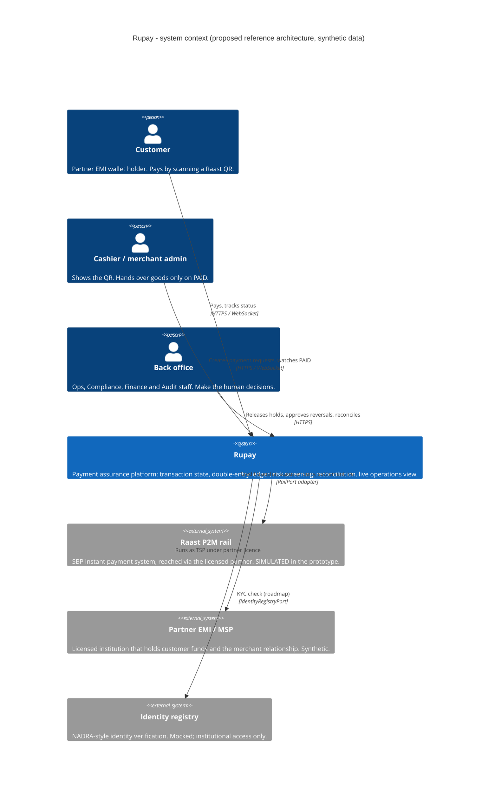
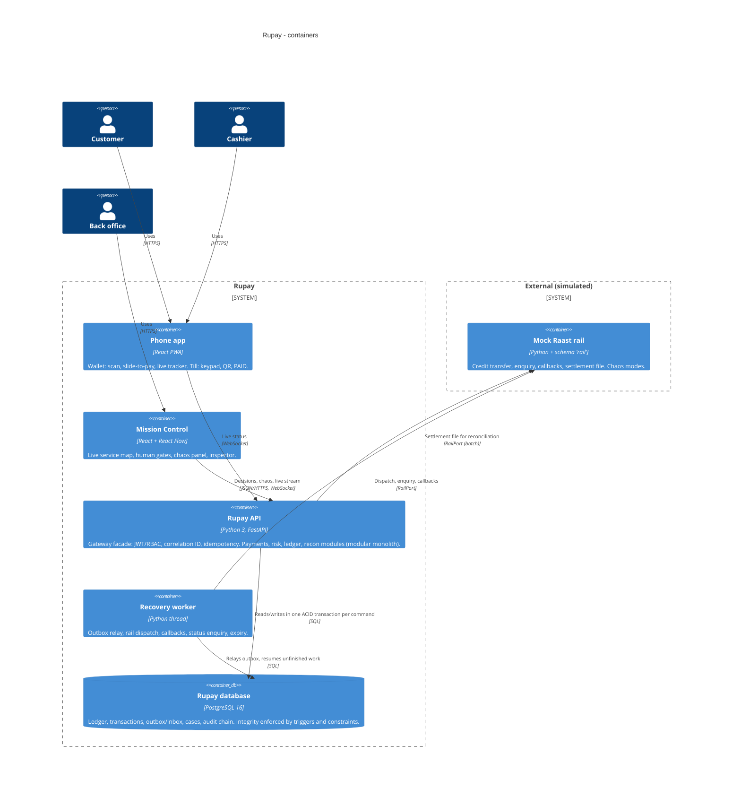

# 02: C4 system context and container views

**Gate:** Week 10, C4 context. The container view is included so the sequence diagrams have named participants.
**Rendered images:** `rendered/c4-context.svg`, `rendered/c4-container.svg`.

## Level 1: system context

**Systems of record** (Week 1: record / engagement / intelligence):

| Data object | System of record | Classification | Who may change it |
|---|---|---|---|
| Customer master, consent, KYC tier | Rupay customer master (`customers`, `consents`) | Record | Onboarding/KYC process only |
| Merchant master, Raast alias, settlement IBAN | Rupay merchant master (`merchants`) | Record | Merchant onboarding; IBAN change needs dual approval (roadmap) |
| Payment request (QR / order) | Rupay payments (`payment_requests`) | Record | Cashier creates; system expires |
| Transaction state | Rupay transaction service (`transactions` + `transaction_status_history`) | Record | State machine only (`state.py`) |
| **Internal financial truth** | **Rupay ledger** (`journals`, `ledger_entries`) | **Record** | Posting service only; append-only |
| External rail claims | Raast (simulated: `rail.payments`, settlement file) | External record | Rail only. **Never copied into the ledger without a matching transaction.** |
| Risk decisions | Rupay risk (`screening_results`, `cases`) | Record | Rules engine; humans for holds |
| Notifications | Rupay notifier (`notifications`) | Engagement | Consumer of events. **Never a source of truth.** |
| Metrics, Mission Control view | Derived | Intelligence | Read-only |
| Audit evidence | Rupay audit chain (`audit_log`) | Record | Append-only, hash-linked |

## Level 2: containers

## Bounded contexts (inside the API container)

| Context | Module | Owns | Talks to others by |
|---|---|---|---|
| Gateway | `api/main.py`, `idempotency.py`, `security.py` | Idempotency keys, sessions | In-process calls |
| Payments | `payments.py`, `state.py` | Payment requests, transactions, state history | Calls Ledger and Risk; emits events |
| Ledger | `ledger.py` | Accounts, journals, entries, holds | Called only by Payments and Recon |
| Risk & Compliance | `risk.py` | Screening results, compliance cases | Called by Payments |
| Rail integration | `rail.py` | Circuit breaker, adapter | `RailPort` interface |
| Reconciliation | `recon.py` | Recon runs, recon items, break cases | Reads rail file; calls Ledger |
| Events | `events.py`, `notifications.py` | Outbox, inbox, notifications | Outbox / subscribers |
| Audit | `audit.py` | Hash-chained audit log | Called by all decision points |

The decision to use one deployable (a modular monolith) instead of microservices is recorded in [ADR-001](adr/ADR-001-modular-monolith-sync-and-async.md).
