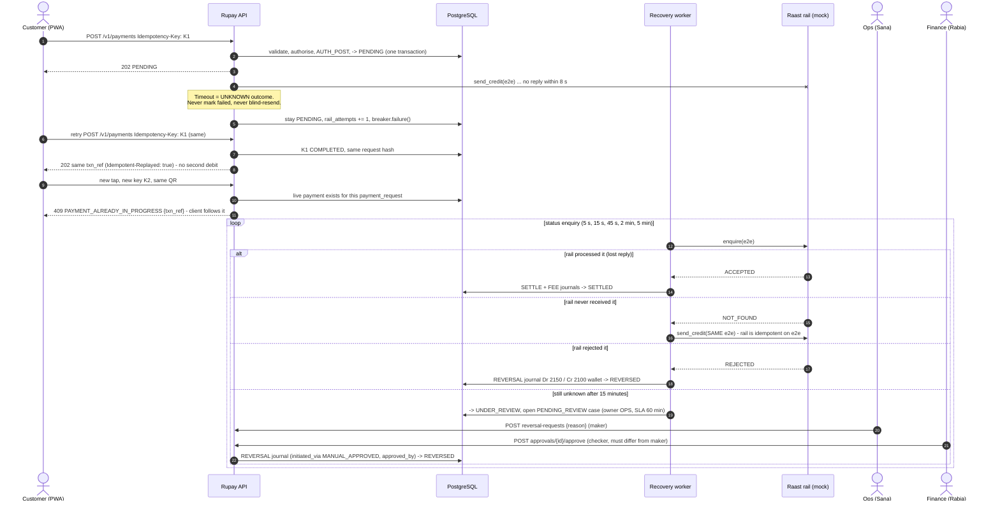
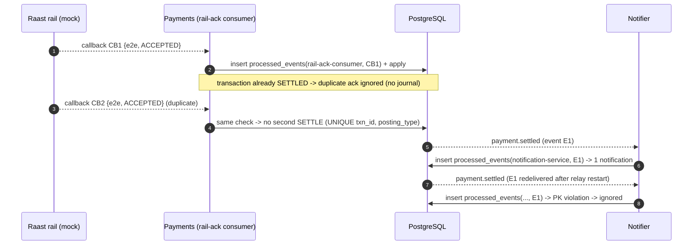

# 04: Transaction sequence diagrams

**Gate:** Week 10, sequence diagram (the brief asks for one normal flow and at least one failure).
**Participants** match the C4 containers in `02-c4-context-and-container.md`. **Steps** match the code in `src/paya/payments.py`.
Amounts are integer paisa: PKR 2,450.00 = 245000.

## A. Normal flow: QR payment, settlement and reconciliation

```mermaid
sequenceDiagram
  autonumber
  actor C as Customer (PWA)
  actor K as Cashier (till)
  participant API as Rupay API (gateway)
  participant DB as PostgreSQL (ledger, outbox)
  participant W as Recovery worker / relay
  participant R as Raast rail (mock)
  actor F as Finance (Rabia)

  K->>API: POST /v1/payment-requests {amount 245000, order_ref}
  API->>DB: insert payment_request (OPEN, expires 15 min)
  API-->>K: 201 {id, qr_payload}
  C->>API: POST /v1/payments {payment_request_id}<br/>Idempotency-Key: K1, X-Correlation-ID: c1
  API->>DB: insert idempotency (user, op, K1, hash) IN_PROGRESS
  rect rgb(20,40,30)
  note over API,DB: ONE database transaction - all or nothing
  API->>DB: lock payment_request, refuse if a live payment exists
  API->>DB: transaction CREATED + event payment.created
  API->>DB: risk screen (KYC tier, limit, velocity, watch-list) -> VALIDATED
  API->>DB: lock wallet row, available = ledger - holds, place hold -> AUTHORISED
  API->>DB: journal AUTH_POST: Dr 2100 wallet / Cr 2150 in transit -> POSTED
  API->>DB: assign rail_e2e_id, schedule enquiry -> PENDING (+ outbox events)
  end
  API->>DB: idempotency K1 COMPLETED (store response)
  API-->>C: 202 {txn_ref, status PENDING, "Sent - awaiting confirmation"}
  API->>R: send_credit(e2e, 245000, merchant alias)
  R-->>API: ACCEPTED (rail_ref)
  rect rgb(20,40,30)
  API->>DB: journal SETTLE: Dr 2150 / Cr 1010 settlement account
  API->>DB: journal FEE: Dr 1300 merchant receivable / Cr 4100 income (1225)
  API->>DB: -> SETTLED, payment_request PAID, outbox payment.settled
  end
  W->>DB: relay unpublished outbox rows (in seq order)
  W-->>C: payment.settled (WebSocket) -> "Paid"
  W-->>K: payment.settled (WebSocket) -> full-screen PAID + voice
  W->>DB: notifier consumes once (processed_events) -> notification rows
  F->>API: POST /v1/finance/recon/run
  API->>R: settlement_file(today)
  R-->>API: lines + trailer (count, value total, sha256)
  API->>DB: verify trailer, file hash unique, match e2e + amount -> RECONCILED
  API-->>F: {MATCHED: 1, match_rate: 1.0}
```

**Evidence:** `test_s1_normal_success_end_to_end`, `evidence/screenshots/09-*.jpg` to `11-*.jpg`.

## B. Failure flow: downstream timeout with unknown outcome (Week 9 outage scenario)

**Evidence:** `test_s4_*` (lost reply and never received), `test_s11_*` (new key blocked), `test_s5_*` (reject leads to reversal), `test_s6_*` (maker-checker), `test_s12_*` (outage and circuit breaker). Mission Control shows this live under the chaos modes **Lost reply** and **Lost request**.

## C. Failure flow: duplicate acknowledgement and duplicate event

**Evidence:** `test_s3_duplicate_ack_and_duplicate_event_have_no_second_effect`.
