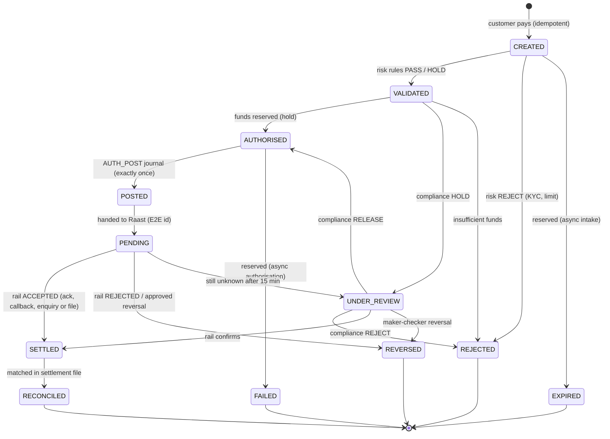

# 05: Transaction state model

Source of truth: `src/paya/state.py`. Any transition not listed below is refused with `IllegalTransition`. Every allowed transition makes three writes in the same database transaction: an optimistic-locked `UPDATE … WHERE status = :expected AND version = :v`, an append to `transaction_status_history`, and an outbox event.

## Per-state controls (Week 9 requirement: owner, evidence, timeout, retry rule, reversal rule)

| State | Owning component | Evidence stored | Timeout | Retry rule | Reversal rule | Customer sees |
|---|---|---|---|---|---|---|
| CREATED | Transactions | Idempotency key, correlation ID, payment request | QR expiry 15 min | Same key replays | None (no money moved) | Processing |
| VALIDATED | Risk | `screening_results` (rules fired, data used, rule version) | Compliance SLA 4 h | Business rejects never retried | None | Processing |
| AUTHORISED | Ledger | Hold row (amount, expiry) | Hold 30 min (expired holds released by the worker) | Idempotent | Release hold | Processing |
| POSTED | Ledger | Balanced AUTH_POST journal | n/a | `UNIQUE(txn_id, posting_type)` | Compensating REVERSAL journal | Sent - awaiting confirmation |
| PENDING | Rail integration | `rail_e2e_id`, attempts, enquiry schedule | 8 s call; 15 min overall | Enquire; resend only on NOT_FOUND, with the same E2E | Only on rail reject or approved reversal | Sent - awaiting confirmation |
| SETTLED | Ledger + rail | SETTLE + FEE journals, rail reference | File line expected by D+1 | n/a | **No reversal after finality.** Refund is a new linked transaction (roadmap) | **Paid** |
| RECONCILED | Reconciliation | `recon_items` = MATCHED, run id, file hash | n/a | n/a | Adjustment only through an approved recon case | Paid |
| UNDER_REVIEW | Ops / Compliance | Case (owner, SLA, reason) | Case SLA, then escalation | Humans decide | Maker-checker | Under review |
| REVERSED | Ledger | REVERSAL journal on a linked transaction, approvals | n/a | n/a | n/a | Returned to wallet |

In the current build, validation, authorisation and posting happen in **one** database transaction. So `CREATED → EXPIRED` and `AUTHORISED → FAILED` are allowed by the state machine but not yet reachable. They are reserved for an asynchronous authorisation step, such as a card or bank-pull leg. An expired payment request is refused before any transaction is created (`409 PAYMENT_REQUEST_CLOSED`).

`recon_result` is a **separate attribute**. A REVERSED payment that later shows up in a settlement file is still reconciled and raises `STATUS_MISMATCH`. That is how the Week 9 trap is caught: the settlement file includes a payment the wallet marked as failed.
