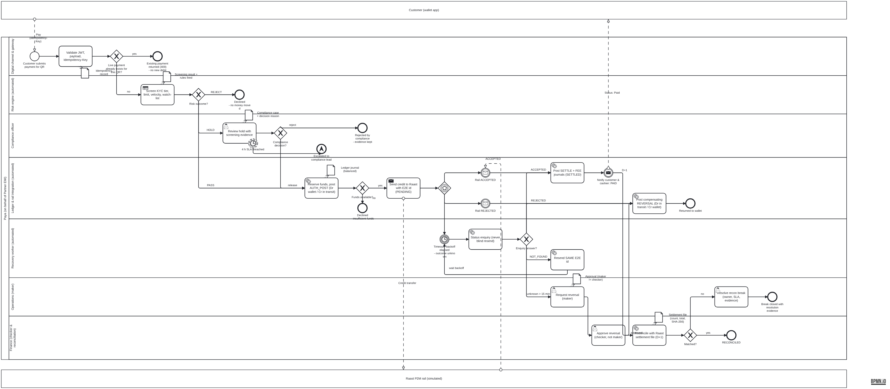

# 06: BPMN 2.0 payment journey (to-be process)

**Model:** `bpmn/payment-journey.bpmn`. It opens in [bpmn.io](https://demo.bpmn.io) and Camunda Modeler, and imports with zero warnings.
**Source:** `bpmn/build_bpmn.py`. The model is generated from code so lanes, IDs and labels stay consistent with the state machine. Run it again after any change.
**Rendered image:** `rendered/bpmn-payment-journey.svg` / `.png`.

## Pools, lanes and why they are drawn this way

Week 3 says that "lane design is an organisational design decision":

| Pool / lane | Who or what is accountable | Kind of work |
|---|---|---|
| Customer (collapsed pool) | Wallet holder | Sends the pay message, receives "Paid" |
| Paya → Digital channel & gateway | Paya platform | Validation, idempotency |
| Paya → Risk engine (automated) | Rules owned by Compliance, executed by the system | Business-rule task |
| Paya → **Compliance officer** | Human | Reviews held payments with the evidence |
| Paya → Ledger & rail integration (automated) | Paya platform | Postings, send to rail, wait for the rail's answer |
| Paya → Recovery worker (automated) | Paya platform | Timer, status enquiry, safe resend |
| Paya → **Operations (maker)** | Human | Requests reversal; owns breaks that are missing on the Raast side |
| Paya → **Finance (checker & reconciliation)** | Human | Approves reversal; reconciles; owns breaks that involve money mismatches |
| Raast P2M rail (collapsed pool) | External, simulated | Message flows only (no sequence flow crosses pools) |

## Exception paths modelled (none are silently ignored)

| Exception | BPMN construct | Outcome and evidence |
|---|---|---|
| Duplicate tap or retry | Exclusive gateway "Live payment already exists?" | End: existing payment returned. Evidence: idempotency record |
| Risk REJECT | Exclusive gateway → end | Declined; no money moved. Evidence: screening result |
| Risk HOLD | Gateway → user task (Compliance) | Release or reject with a recorded reason |
| Compliance SLA breached | **Boundary timer (PT4H, non-interrupting)** → escalation end event | Escalated to compliance lead |
| Insufficient funds | Exclusive gateway → end | Declined |
| Rail answer | **Event-based gateway**: ACCEPTED message / REJECTED message / timer | Settle / reverse / recover |
| Timeout, outcome unknown | Timer → status enquiry → gateway | ACCEPTED → settle. REJECTED → reverse. NOT_FOUND → resend the same E2E, then wait again. Unknown > 15 min → human |
| Unknown too long | User task (Ops, maker) → user task (Finance, checker) | Reversal with maker ≠ checker. Evidence: approval record |
| Reconciliation break | Exclusive gateway "Matched?" → user task | Break resolved with owner, SLA and evidence |

## Controls and evidence (data objects)

| Data object | Produced by | Why it matters |
|---|---|---|
| Idempotency record | Validate | Proves a retry had no second effect |
| Screening result + rules fired | Risk engine | Explains every hold or decline (rule version kept) |
| Compliance case + decision reason | Review | Week 3 KYC requirement: reviewer and reason captured |
| Ledger journal (balanced) | Reserve and post | Accounting truth; append-only |
| Approval (maker ≠ checker) | Request reversal | Segregation of duties, also enforced by a database CHECK |
| Settlement file (count, total, SHA-256) | Reconcile | Completeness and duplicate-file control |

## Peer-review defect log (Week 3 method)

We reviewed our own first draft of this model against the Week 3 checklist. These are the defects we found and fixed:

| # | Defect type | Defect found in draft 1 | Fix in this version |
|---|---|---|---|
| 1 | Scope / lane | "Post compensating reversal" (a system task) sat in the Operations (human) lane | Moved to the automated *Ledger & rail integration* lane |
| 2 | Scope | Timer, status enquiry and resend were spread across Finance and Ops lanes | Added a dedicated *Recovery worker (automated)* lane |
| 3 | Control | The timer had no visible consequence other than looping ("timer with no consequence") | Added the "unknown > 15 min" branch to a human maker-checker path |
| 4 | Ambiguity | The resend looped straight back to the event-based gateway, which implied a blind resend | The resend now goes to *timer / backoff elapsed*, then another enquiry |
| 5 | Notation | Branch labels overlapped, so readers could not tell HOLD from PASS | Labels placed at the branch bends; gateway labels are questions |
| 6 | Evidence | The approval data object was attached to the checker only | Attached to the maker step, where the request and reason are recorded |

## Link to process mining (Week 2 / Week 3)

`transaction_status_history` already holds the minimum event-log fields: **case ID** (`txn_id`), **activity** (`to_status`), **timestamp**, **resource** (`actor`) and **object** (transaction, plus linked reversal and case). That makes the designed model testable against observed behaviour. `test_conformance_no_settlement_without_authorisation_and_posting` replays this event log across normal, timeout-recovery and compliance-release cases. It checks the designed order: no case reaches SETTLED without first passing AUTHORISED, POSTED and PENDING.
