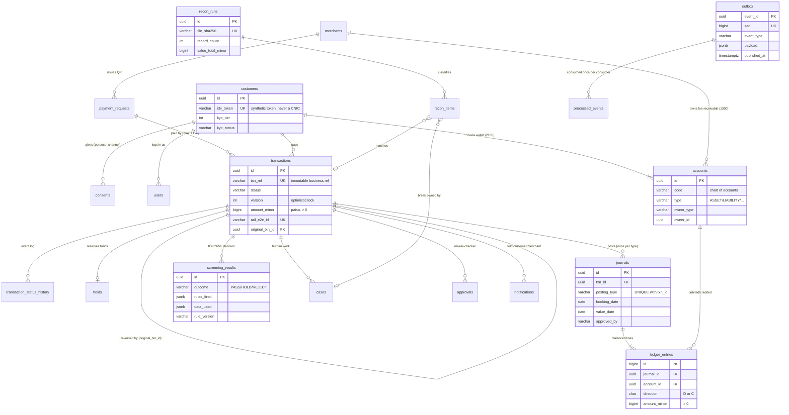

# 07: Data model (ERD)

**Gate:** Week 12, data/control gate.
**Generated artefacts** (from the code, never edited by hand): [`generated/erd-full.md`](generated/erd-full.md) has all 23 tables, and [`generated/table-dictionary.md`](generated/table-dictionary.md) lists every column and constraint. Regenerate them with `python docs/architecture/tools/gen_erd.py`.

## Core view

The brief lists the entities a minimum model must contain: customer, wallet/account, transaction, ledger entry, event, KYC/AML decision and reconciliation. Every one of them is below, with the relationships Paya actually implements:

The `customers → accounts` and `merchants → accounts` links are **logical**: `accounts.owner_type` + `owner_id` point at the owner without a foreign key, because one account table serves customers, merchants and house accounts. Uniqueness is enforced by `UNIQUE(code, owner_type, owner_id)`.

The external rail keeps its **own** tables in a separate schema (`rail.payments`, `rail.callbacks`). There are no foreign keys between `rail.*` and our tables. Reconciliation joins them by `rail_e2e_id` only. That keeps external claims and internal truth apart, as the brief requires.

## Design decisions in the model

| Decision | Why | Where enforced |
|---|---|---|
| Money is `BIGINT` paisa, never float | Floats cannot represent PKR 0.10 exactly; rounding drift breaks reconciliation | `ck_entry_positive`, `ck_txn_amount` |
| Balances are **derived** from `ledger_entries` | A stored balance can disagree with its own history (lost update) | No balance column exists |
| `txn_ref` immutable and unique; `rail_e2e_id` unique | Stable identity for tracing, duplicate detection and reconciliation (Week 9) | Unique constraints |
| Corrections are new rows that link to the original | Evidence of what happened and why is preserved (Horizon lesson) | `original_txn_id`; `ck_correction_links_original`; append-only triggers |
| `transaction_status_history` holds case, activity, timestamp, resource and object | Process mining and conformance (Week 2) are possible on real data | Append-only trigger |
| `screening_results` store the rules fired **and the data used** | A decision can be explained and reproduced; rule version kept (Week 6: configuration is a control) | JSONB columns |
| No CNIC, biometric, IBAN or card columns | Data minimisation; the brief forbids real identifiers | Schema review; `idv_token` and `settlement_iban_masked` only |
| One `cases` table for compliance holds, pending reviews and reconciliation breaks | One exception model: owner, SLA, state, resolution (Week 9 exception case model) | `cases.owner_role`, `sla_due_at` |

## Integrity guarantees in the database (not only in the application)

| Guarantee | Mechanism | Proven by |
|---|---|---|
| Every journal balances | Deferred constraint trigger `trg_journal_balanced` | `test_ledger_is_append_only_and_unbalanced_journals_are_refused` |
| History cannot be edited | `BEFORE UPDATE OR DELETE` triggers on `ledger_entries`, `journals`, `audit_log`, `transaction_status_history` | same test |
| A posting type happens once per transaction | `UNIQUE(txn_id, posting_type)` | `test_s3_*`, `test_s4_*` |
| One live payment per QR | Partial unique index `uq_one_live_payment_per_request` | `test_s11_*` |
| One reversal per original | Partial unique index `uq_one_reversal_per_original` | schema |
| Maker ≠ checker | `CHECK (approved_by <> requested_by)` | `test_s6b_*` |
| Same settlement file cannot be imported twice | `UNIQUE(file_sha256)` | `test_s13_*` |
| Consumer processes each event once | `PRIMARY KEY(consumer, event_id)` | `test_s3_*` |
