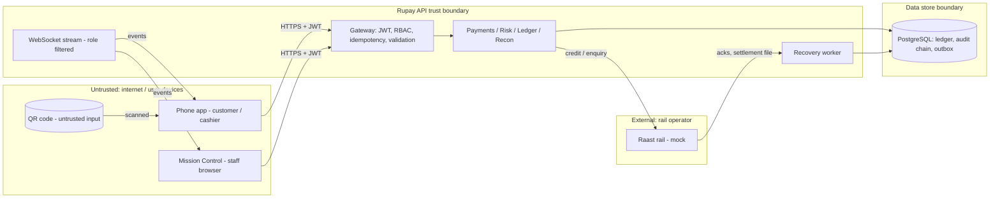

# 11: Threat model and risk-control matrix

**Gate:** Week 13, security/observability.
**Method:** STRIDE on the data-flow diagram below, then the Week 14 lecture structure: list attack paths, prioritise two, and give each risk preventive, detective and recovery controls with the residual risk stated.
**Scope:** the Rupay prototype as built (PWA, Mission Control, API with in-process worker, PostgreSQL, mock rail). It assumes deployment as documented in the README: local Compose, with an optional HTTPS tunnel plus Vercel for demos.

## 1. Data flow and trust boundaries

## 2. STRIDE analysis

| ID | STRIDE | Threat | Where | Preventive control (built) | Detective control (built) | Recovery control | Residual risk |
|---|---|---|---|---|---|---|---|
| T-01 | Spoofing | Credential stuffing or brute force on staff accounts | `/v1/auth/login` | Argon2id hashes; lock after 5 failures in 15 min (429) | Every failure and lockout in the audit chain; `security.login_locked` telemetry | Lock expires after 15 min; admin can deactivate the user (`users.active`) | **Low-medium.** Durable lockout and per-address limits (ADR-016); staff TOTP, required outside demo mode (ADR-017). Residual: shared demo password in demo mode, where MFA is opt-in |
| T-02 | Spoofing | Stolen JWT replayed (e.g. via XSS) | PWA local storage | 60-min expiry; HS256 secret of 32+ chars from env; strict JSON APIs | Audit trail of actions per user and correlation ID | Rotate `PAYA_JWT_SECRET` to invalidate every token | **Low-medium.** Every token names a server-side session checked on each request, so a stolen token is revoked in seconds per person (ADR-017). Residual: tokens live in `localStorage`; production: httpOnly cookies or OIDC |
| T-03 | Tampering | Changing an amount or ledger history after the fact | DB | Append-only triggers on ledger, journals, audit and status history; balanced-journal trigger; app has no UPDATE path | `GET /v1/audit/verify` hash chain; integrity check `trial_balance_balanced` | Restore from backup (drill D3); correcting journals | **Low.** The app connects as `paya_app` (ADR-015): no UPDATE/DELETE on evidence, cannot ALTER or disable triggers. Residual: a stolen *owner* credential, which the API never holds in Compose |
| T-04 | Tampering | Double spending through concurrent or retried requests | `/v1/payments` | Idempotency key; one live payment per QR; wallet row lock; `UNIQUE(txn_id, posting_type)` | `no_negative_wallets`, `in_transit_equals_open_payments` checks | Compensating reversal | **Low.** Proven by S2, S11 and the concurrency regression test |
| T-05 | Tampering | Forged or replayed rail acknowledgement | Rail callback path | Inbox de-duplication; acks matched by E2E id to our own outstanding payments only | Reconciliation against the settlement file (STATUS_MISMATCH, MISSING_INTERNAL) | Claim journal + Finance case | **Medium.** The mock has no message signing. Production: mTLS plus signed messages from the rail operator |
| T-06 | Repudiation | Staff deny approving a reversal or releasing a hold | Back office | Named accounts; one role per user | Audit chain (who, what, when, why, how); journals store `actor` and `approved_by` | n/a | **Low** |
| T-07 | Information disclosure | Customer reads another customer's payments | `/v1/transactions/{ref}`, WebSocket | Ownership checks return 404 (references not revealed); stream filtered by role and ownership | Denied attempts audited | n/a | **Low** (S8 test) |
| T-08 | Information disclosure | Secrets or PII in logs | JSON logs, telemetry | Key-based scrubbing (`password`, `token`, `authorization`, `cnic`, `iban`…); no PII in schema; IDs only in events | Log review | Rotate a leaked secret | **Low** (unit tested) |
| T-09 | Denial of service | Request flood or a slow rail exhausting threads | API, rail calls | Circuit breaker refuses new payments **before** debiting; 8 s rail timeout | `paya_rail_breaker_open`, latency histograms, `outbox_relay_lag` | Restart is safe (drill D1: 1.3 s healthy) | **Medium.** Per-client ceiling on every `/v1` call and durable limits on login, onboarding and chat (ADR-016); one process caps at ~16 payments/s. Production: the ceiling moves to a gateway; horizontal scaling |
| T-10 | Elevation of privilege | A staff member both requests and approves a reversal | Back office | Role split OPS / FINANCE; app check; DB `CHECK approved_by <> requested_by` | Denial audited in its own transaction | n/a | **Low** (S6, S6b, S6c) |
| T-11 | Elevation of privilege | Chaos or demo controls abused in production | `/v1/chaos/*` | Disabled unless `PAYA_DEMO_MODE=true`; restricted to SYSADMIN/OPS | Every mode change audited | Set demo mode off | **Low** if the deployment checklist is followed |
| T-12 | Tampering / phishing | Malicious QR causes open redirect or a fake merchant | Scanner | QR accepted only as `paya://pay?pr=<UUID>`; merchant name comes from **our server**, never from the QR | Payment shows server-side merchant before slide-to-pay | n/a | **Low.** Two moderate react-router 6.x advisories remain (fix needs v7); compensated by UUID-only routing |
| T-13 | Spoofing (business) | Fake payment screenshot shown to a cashier | Till | The till shows PAID only from ledger-backed settlement status; audio confirmation | n/a | n/a | **Low inside Rupay**; cashier training still required |
| T-15 | Tampering / EoP | Prompt injection through rail free text makes the AI agent recommend or perform a harmful action | AI triage agent | Agent has no money-moving capability (source-checked test); text is quoted data; output allow-list and evidence validation; rules fallback | Every suggestion audited with prompt hash; override rate monitored | Unset `PAYA_AI_URL`; humans work cases unassisted | **Low** (`test_llm_output_is_used_only_when_it_passes_the_guardrails`; 20/20 injection cases safe) |
| T-16 | Spoofing | Printed photo, screen replay or deepfake passes onboarding liveness | Onboarding | Random head-turn challenge, single-use nonce, 120 s expiry, distinct frames, same-person check, card-face match | Every check stored with scores and engine version | Raise referral rate; pause auto-approval (set face engine to none) | **Medium.** Basic active liveness is not certified PAD (doc 16 §8) |
| T-17 | Information disclosure | Breach exposes applicants' photos or face templates | Onboarding | Nothing biometric is stored; keyed digests only; abandoned data purged after 72 h | Test K9 scans every column | n/a | **Low** |
| T-18 | Elevation of privilege | One compliance officer approves a possible sanctions match alone | Compliance | Two-person rule in service and DB `CHECK`; denial audited separately | Audit chain | n/a | **Low** (K7) |
| T-19 | Repudiation / fairness | An applicant is refused by an algorithm with unequal error rates | Onboarding | No automatic rejection; every non-pass goes to a person with evidence | Referral and override rates | n/a | **Low** for refusal; fairness of auto-approval still needs evaluation on consented data |
| T-20 | Tampering / EoP | Prompt injection or social engineering in chat makes the assistant move money or reveal data | Rupay Assistant | No money-moving imports (source-checked); deterministic intents; customer-scoped tools; actions are links into confirmed flows | Intent and tools logged per message; handoff and transcript reads audited | Disable the assistant route | **Low** (C3, C4, C9) |
| T-21 | Information disclosure | Customers paste card, CNIC or OTP into chat and it is logged | Rupay Assistant | Redaction before classification and storage; 30-day retention; staff reads audited | Redaction count monitored | n/a | **Low** (C5) |
| T-22 | Tampering | A green pot move is double-submitted, or overdraws the wallet or pot | Green pot | Idempotency-Key; wallet and pot row locks; available-balance checks; one journal per move; DB CHECK on types | Integrity checks `no_negative_green_pots`, `green_pot_move_has_one_journal` | Reverse with an ADJUSTMENT journal (maker-checker) | **Low** (G2–G4, G9) |
| T-23 | Repudiation / misleading claim | A customer is told they offset carbon that was never paid, or an estimate is presented as fact | Green (footprint, offsets) | Certificate derived only from a SETTLED payment; every footprint labelled an estimate with method, band and factor version | Offsets reconcile like any payment | Withdraw the certificate view; the payment record stands | **Low** (G1, G7) |
| T-24 | Information disclosure | Staff read an individual's spending footprint (behavioural profiling) | Green, Mission Control | Customer-only endpoints (`green:use`); staff get portfolio aggregates only | Access denials audited | n/a | **Low** (G8) |
| T-25 | Tampering | A client changes a price, applies an offer twice, or pays the same bill twice | Super app checkout | Server catalogue and bill registry; offer once per customer; one live order per bill (advisory lock); order state read from the payment | `service_order_matches_payment_request` | Cancel the open request; a settled duplicate is refunded via maker-checker reversal | **Low** (P2, P5, P6) |
| T-26 | Information disclosure | A partner receives customer data it does not need, or without consent | Partner integration | Declared scopes per partner; revocable per-partner consent (audited); shared fields stored on the order | `partner_data_shared_only_with_consent` | Suspend the partner | **Low** (P7, P11) |
| T-27 | Denial / third-party failure | A partner misbehaves (fraud, complaints, outage) and customers keep paying it | Partner registry | Compliance kill switch with reason, audited; new orders refused; existing payments settle | Partner volumes and status in Mission Control | Suspend, then resume after review | **Medium** (P8) |
| T-28 | Repudiation / misleading claim | The sandbox is mistaken for a real payment method, or tokens are treated as money | Stablecoin sandbox | Off by default (`FEATURE_DISABLED`); disclaimer and acknowledgement; no rupee conversion; source check; ledger scan | `sandbox_tokens_never_in_rupee_ledger` | Unset the flag | **Low** (SC1, SC2, SC4, SC12) |
| T-29 | Tampering | A transfer shown as confirmed is undone by a reorg, or Rupay's record disagrees with the chain | Token finality | Confirmed only at 3 confirmations; spendable = final minus pending; continuous reconciliation against the chain | `token_transfers_match_chain` | Investigate the break; the chain is the system of record for tokens | **Low** (SC3, SC6, SC11) |
| T-30 | Elevation / illicit use | Tokens sent to a sanctioned or fraud address, or above limits without beneficiary data | Token compliance | Address screening (block + Compliance case + audit); per-transfer and daily limits; travel-rule beneficiary data; tier-2 only | Blocked transfers and cases in Mission Control | Disable the flag | **Low** (SC7, SC8) |
| T-14 | Supply chain | Vulnerable dependency | Python / npm | Exact or narrow version pins | `pip-audit` (0 known); `npm audit` (2 moderate, compensated) in `evidence/security/` | Upgrade path recorded | **Low–medium.** Re-run audits before the final defence |

## 3. Top attack paths, and the two we prioritised

| # | Attack path | Likelihood | Impact | Priority |
|---|---|---|---|---|
| AP-1 | Attacker retries or races payment requests to spend the same balance twice | High (normal network behaviour causes it by accident) | High (money loss, broken ledger) | **1, mitigated and tested** |
| AP-2 | Insider reverses a payment to themselves, or releases a sanctioned customer's hold, alone | Medium | High (fraud, regulatory breach) | **2, mitigated and tested** |
| AP-3 | Stolen staff token used from another device | Medium | High | Revocation per session or per person, and staff TOTP (ADR-017) |
| AP-4 | Forged rail callback marks an unpaid payment as settled | Low (needs network position) | High | Production control: mTLS and signing (gap in mock) |
| AP-5 | Flood of payment requests during the rail outage | Medium | Medium | Breaker plus the per-client ceiling (ADR-016) |

**AP-1 controls:**
- Preventive: idempotency key, business uniqueness, row locks, posting uniqueness.
- Detective: integrity checks.
- Recovery: compensating reversal.
- Evidence: S2, S11, `test_concurrent_*`, and the load test (0 duplicate settlements in 400 payments, including a duplicate-ack storm).
- Residual: low.

**AP-2 controls:**
- Preventive: role split, plus maker ≠ checker in both application and database.
- Detective: hash-chained audit, including the refused attempt.
- Recovery: correcting journal by a different approver.
- Evidence: S6, S6b, S6c, S7.
- Residual: low. Collusion between two people is still possible; that is mitigated organisationally by audit review.

## 4. Gaps carried forward

The following open risks are also listed in the technical debt register:
- Signed rail messages.
- `react-router` v7 upgrade.
