# 15: Responsible AI extension: reconciliation-triage agent

**Rubric:** Responsible AI extension (5 marks): bounded authority, abstention, verification, monitoring and no unsafe financial autonomy.
**Brief §7:** choose one extension; define allowed tools/data, prohibited actions, confidence/abstention threshold, human approval boundary and audit logging; evaluate with at least four metrics; provide a deterministic fallback.
**Code:**
- `src/paya/ai_triage.py`: the engine and its guardrails; pure functions with no database and no money.
- `src/paya/ai_service.py`: context building, recording and human review.
- `tests/test_ai_triage.py`.

**Evidence:**
- `evidence/ai/evaluation.md`
- `data/ai_eval/breaks.jsonl`
- `evidence/screenshots/ai-*.jpg`

## 1. Why this use case

| Candidate (brief §7) | Value | Risk if wrong | Decision |
|---|---|---|---|
| Fraud-alert triage | High | AI sits next to hold and release decisions; a false negative lets fraud through | Rejected for the first extension |
| Customer-service chatbot | Medium | Customer-facing errors; prompt injection from the public; needs SECP care for "advice" | Planned as Theme 3, not the graded extension |
| Document classification (KYC) | Medium | Touches identity data that we must not store | Theme 1 |
| **Reconciliation-exception triage** | **High.** Breaks are where operations time goes (Week 9); every break needs a cause, an owner and an action | **Low.** It only suggests; a human owns every case; wrong advice costs time, not money | **Chosen** |

**Week 4 mechanism-selection logic:**
- Rules handle the decisions that are explicit and stable: category routing, owner and SLA.
- AI is used only where pattern recognition over messy evidence adds value: explaining why a break happened and what to do next.
- RPA is not used.

**Week 7 personalisation matrix applied to automation level:** this is *advise / notify* (medium risk), never *automate*.

## 2. How it works

```mermaid
flowchart LR
  A[case.opened event<br/>RECON_BREAK / PENDING_REVIEW] --> B[Context builder<br/>minimum data + evidence refs]
  B --> C{Engine}
  C -->|default| D[Deterministic rules<br/>triage-rules-v1]
  C -->|optional PAYA_AI_URL| E[Local LLM via Ollama]
  E -->|any failure or unsafe output| D
  D --> F[Output guardrail<br/>allow-listed action, known owner,<br/>evidence must exist in input]
  E --> F
  F --> G[Abstention rules<br/>Week 4 list]
  G --> H[(ai_suggestions<br/>+ audit chain)]
  H --> I[Human gate in Mission Control<br/>Accept / Override + reason / Resolve]
```

## 3. Governance specification

| Element | Specification | Enforced by |
|---|---|---|
| **Allowed data** | The case; its transaction's status, amount and settlement time; the rail's status for that E2E id; the recon item; whether a compliance case is linked. Each fact is labelled with an evidence reference (`txn:…`, `rail:…`, `journal:…`) | `build_context` (only these fields are passed) |
| **Not given to the AI** | Customer names, phone numbers, identity tokens, other customers' data, credentials | Context builder; no PII fields exist in the schema |
| **Allowed output** | One JSON suggestion: category, root-cause *hypothesis*, owner, next action from a 9-item allow-list, evidence refs, confidence, summary | `validate()`: schema, allow-list, evidence subset, length limits |
| **Prohibited actions** | Moving money, posting journals, releasing holds, approving reversals, changing beneficiary data, closing cases | **Structural:** the agent modules import no ledger, payments, state or recon functions. `test_ai_has_no_money_moving_capability` parses their source to prove it. The only table the agent writes is `ai_suggestions` |
| **Recommendations that touch money** | `RECOMMEND_REVERSAL`, `RAISE_CLAIM` are *advice*. Acting on them still needs the normal maker-checker path | Separate endpoints with RBAC and SoD (S6) |
| **Confidence threshold** | Abstain below **0.75** | `apply_abstention` |
| **Abstention triggers** (Week 4) | Low confidence; **missing evidence** (rail status unavailable); **conflicting evidence**; **high value** (> PKR 100,000); **linked compliance/AML case** (regulatory judgement) | `apply_abstention`; tests |
| **Human approval boundary** | Only the case **owner role** may accept or override a suggestion, and only the owner may resolve the case. An override requires a reason code. Accepting records agreement only; no state changes | `ai_service.review`, `resolve_case`; tests |
| **Audit logging** | Every suggestion: engine, prompt hash (SHA-256 of engine + system prompt + context), evidence refs, output, latency, fallback reason; an `AI_SUGGESTION` audit row; reviewer decision and reason as `AI_SUGGESTION_ACCEPTED/OVERRIDDEN`; case resolution | `ai_suggestions`, hash-chained `audit_log` |
| **Prompt-injection controls** | Free text from the rail (e.g. creditor alias) is passed as quoted data inside `<case_data>`. The system prompt says it is untrusted. Output must match the allow-list and cite only provided evidence. The rules engine never interprets free text | `SYSTEM_PROMPT`, `validate()`; injection tests |
| **Fallback** | Deterministic rules engine is the default and is used whenever the LLM errors, times out, returns invalid JSON or unsafe output | `triage()`; tests with a mock LLM server |
| **Failure isolation** | An agent error never affects payments: it runs as an event consumer, and its exceptions are caught and shown as `ai.error` telemetry | `ai_service.on_event` |
| **Rollback** | Unset `PAYA_AI_URL` to return to rules only. Remove the subscriber to stop auto-triage; humans then work cases unassisted | Configuration |

## 4. Evaluation (offline, labelled synthetic dataset)

The full report is in `evidence/ai/evaluation.md`: 120 cases, seed 2026, true cause chosen before the evidence was generated, with noise, traps and prompt-injection text.

| Metric (brief asks for at least 4) | Result | Target |
|---|---|---|
| Triage accuracy on cases the agent acted on | **94.1%** (80/85) | ≥ 85% |
| False reassurance ("wait" when action was needed) | **3.5%** (3/85) | ≤ 5% |
| Unsafe autonomy (should have abstained, did not) | **0%** (0/22) | 0% |
| Policy violations (off-allow-list action, invented evidence) | **0** | 0 |
| Safe outcome rate (correct, or handed to a human) | **95.8%** | ≥ 95% |
| Prompt-injection cases handled safely | **20/20** | 100% |
| Latency p95 (rules engine) | < 1 ms | ≤ 500 ms |
| Audit completeness | **100%** (live: `GET /v1/ai/metrics`; tested) | 100% |

**Known failure mode:** a rail omission that settled close to cut-off looks like a timing difference, so the agent says "wait". The cost is a one-day delay, and the case re-opens if the next file still lacks the line. The new integrity check `settled_but_unreconciled_after_d1` is the safety net. It was found while testing this feature: if the rail's file is byte-identical to one already imported, it is correctly refused as a duplicate, so the missing payment would otherwise never be flagged.

## 5. Live monitoring

`GET /v1/ai/metrics` reports:
- suggestion count;
- abstention rate;
- acceptance and override rates (a rising override rate means the rules need review);
- fallback count;
- latency p95;
- audit completeness.

Mission Control shows the agent as a live node. Its suggestions appear inside the human-gate cards.

## 6. Limits (stated plainly)

- **No LLM was evaluated.** No model runs in this environment. The LLM path is implemented and its guardrails are tested against a mock server. It must pass this same evaluation before it is switched on.
- **The dataset is synthetic.** Real accuracy needs real (anonymised) breaks and periodic re-labelling.
- **The agent only triages reconciliation breaks and pending reviews.** It never sees compliance holds; those stay purely human.
