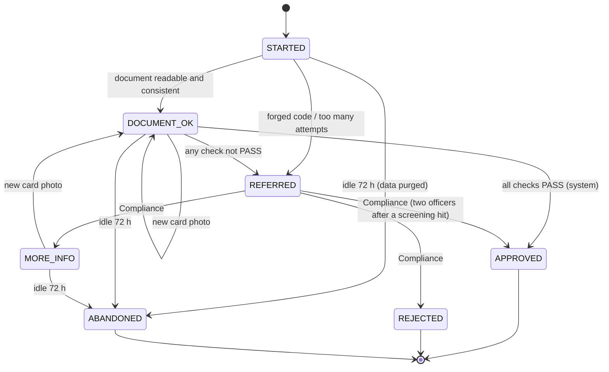

# 16. Digital onboarding and KYC (Theme 1)

**Goal.** A person opens a tier-1 Rupay wallet from their phone in about two minutes, using only synthetic identity data. Clear cases are approved automatically. Everything else is decided by a compliance officer, with evidence.

**What it is not.** Rupay never photographs or stores a real CNIC, never calls NADRA, and never keeps a photo or face template. The identity registry is a simulator (like the Raast rail, ADR-005), and the ID card is a synthetic **SPECIMEN** issued by that simulator.

Code: `src/paya/kyc.py` (journey and rules), `kyc_engines.py` (image and face engines), `registry.py` (simulated registry), `specimen_card.py`. UI: `web/src/pages/app/Onboarding.tsx` and the KYC review card in Mission Control. Decision record: [ADR-010](adr/ADR-010-onboarding-machines-approve-people-decide.md).

## 1. Journey

```mermaid
sequenceDiagram
    autonumber
    actor A as Applicant (phone)
    participant API as Rupay API
    participant K as KYC service
    participant F as Face engine (YuNet + SFace)
    participant R as Identity registry (simulated)
    actor C as Compliance (Kanz / Harris)
    A->>API: start (consent, details, username, password)
    API-->>A: applicant token (30 min, can only finish this application)
    A->>API: specimen
    API->>R: issue synthetic identity
    API-->>A: signed QR code; phone draws the SPECIMEN card with the applicant's photo
    A->>API: document photo
    K->>K: sharpness, brightness, glare; read and verify the signed code; compare name and DOB
    K->>F: is there a face on the card?
    API-->>A: accepted, or what to fix
    A->>API: liveness challenge
    API-->>A: nonce + steps, e.g. CENTER, RIGHT, LEFT (random order, 120 s, single use)
    A->>API: verify (card again + 3 frames + rough location)
    K->>F: one face per frame, head-turn direction, same person in every frame, card face = selfie face
    K->>R: verify identity
    K->>K: watch-list screening, duplicate identity, location
    alt every check passes
        K-->>A: APPROVED - customer, login, tier-1 wallet created in one transaction
    else anything else
        K->>C: KYC_REVIEW case with evidence
        K-->>A: "a person is checking a few details" (no reason given)
        C->>K: approve / reject / ask for a new photo
    end
```

## 2. States



A liveness failure with attempts left (3 in total) is a **retry**, not a state change. Each challenge is single-use even when it fails.

## 3. Checks and decision rules (`kyc.v1`)

| Check | Engine | PASS when | Otherwise |
|---|---|---|---|
| Document quality | OpenCV: variance of the Laplacian ≥ 50, mean brightness 60–215, clipped pixels ≤ 20 % | Readable | Applicant told what to fix; after 5 attempts, referral |
| Document data | QR code reader + HMAC signature | Signature valid; name (similarity ≥ 0.9) and DOB match what was typed; not expired | Mismatch: retake. **Bad signature: immediate referral** (possible forgery) |
| Liveness | YuNet landmarks: yaw ratio = nose offset / eye distance | Centre \|r\| ≤ 0.10; LEFT r ≥ 0.18; RIGHT r ≤ −0.18; steps in the challenged order; frames distinct; one face; same person across frames (cosine ≥ 0.30) | Retry with a tip; after 3, referral. A second face or a different person: referral |
| Face match | SFace cosine, card face vs centre selfie | ≥ 0.363 (the model's published threshold) | 0.30–0.363 grey zone or below: referral |
| Registry | Simulated registry | MATCH | MISMATCH, NOT_FOUND, CANCELLED: referral. **TIMEOUT or DOWN: referral, never approve or reject** |
| Screening | Fuzzy name match (difflib) against the synthetic watch-list | Best similarity < 0.85 | Potential match: referral **with the two-person rule** |
| Duplicate | Keyed hash of the specimen number vs other applications and customers | Unused | Referral |
| Location | Browser geolocation, rounded to 0.01° (~1 km) | Inside Pakistan's bounding box | Not shared, or outside Pakistan: referral |

**Principles** (enforced in code and tests):

1. **Machines approve clear cases. Only people reject.** No algorithm refuses anyone. Biometric matching has known error rates that vary between groups, so a non-match goes to a person, never to an automatic refusal.
2. **Unknown is not no.** A registry that does not answer, or missing face models, means a referral. This is the same principle as ADR-006 (timeout = PENDING).
3. **Loosening needs two people.** Approving a possible watch-list match needs a recommendation and a confirmation by a *different* compliance officer. This is enforced in the service and by the database (`CHECK decided_by <> recommended_by`). A refused self-confirmation is audited in its own transaction. Rejecting, the conservative direction, needs one officer.
4. **No tipping off.** The applicant only ever sees "a person is checking a few details". Screening reasons are visible only to staff.
5. **AI is not in this loop.** The reconciliation-triage agent (doc 15) cannot see or act on KYC cases (`TRIAGED_KINDS`).

Approval creates the customer (tier 1, `VERIFIED`), a `CUSTOMER` login, a `BIOMETRIC_KYC` consent record and a wallet account, all in **one** database transaction. In demo mode only, it also posts a balanced synthetic welcome credit (Rs 5,000), so the new wallet can make a payment in the live demo. Compliance can grant tier 2 when approving, which stands in for enhanced due diligence (EDD), such as video KYC, done outside the system.

## 4. Data: what is kept and what is not

| Data | Kept? | How |
|---|---|---|
| Card photo, selfie frames | **No** | Decoded in memory, checked, out of scope at the end of the request. No `bytea` column exists anywhere (test K9 scans every column of every table for image data) |
| Face templates (embeddings) | **No** | Computed and compared in the same request. The card photo is sent again with the selfies, so no template has to be kept between steps |
| Proof of which image was checked | Yes | Keyed HMAC-SHA256 digest (`input_digest`): it cannot be reversed or looked up. A card swap between steps is detected by comparing digests |
| Specimen number | Only as a keyed hash | `id_number_hash` gives duplicate detection without the number; `customers.idv_token` = `idv_` + hash prefix (unique) |
| Name, DOB, last 4 mobile digits | Yes | Needed for the decision and for record keeping |
| Location | Yes, rounded | Two decimal places (~1 km) + accuracy |
| Password | Hashed (Argon2) | Moved to `users` on approval, then cleared from the application |
| Scores, reasons, engine and model versions | Yes | `kyc_checks` (explainability and audit) |
| Abandoned applications | Purged | After 72 h idle: name, DOB, username, hashes, document data, location and password are cleared |

## 5. Engines and licences

| Engine | Licence | Notes |
|---|---|---|
| OpenCV 4.10 (`opencv-python-headless`) | Apache 2.0 | Quality metrics, QR reader (two readers, plus Otsu fallback), model runtime |
| YuNet `face_detection_yunet_2023mar.onnx` | MIT | Face box + 5 landmarks |
| SFace `face_recognition_sface_2021dec.onnx` | Apache 2.0 | 128-d template; cosine threshold 0.363 |
| *Rejected:* InsightFace pretrained models | Non-commercial research only | Unsuitable for a venture |
| *Not used:* Tesseract OCR | — | The signed QR code is the machine-readable zone. OCR of printed text could be added behind the same interface |

Models are downloaded by `make models` (`python -m paya.fetch_models`) with pinned SHA-256 hashes. A model with the wrong hash is never loaded, and a missing model means every application is referred. The Docker image fetches them at build time, and CI fetches them so the real-model tests run.

## 6. Controls mapped to the threats

| Threat | Control | Proof |
|---|---|---|
| Printed photo or replayed video (presentation attack) | Randomised head-turn challenge, single-use nonce, 120 s expiry, distinct frames, same person across frames | K4, K14, e2e |
| Someone else's or a forged card | Signed code (HMAC); name and DOB cross-check; card-face vs selfie match; card digest pinned between steps | K3, K5 |
| One identity, many wallets (mule accounts) | Keyed hash of the identity number, unique `idv_token` | K8 |
| Sanctioned person onboarded | Fuzzy screening; two-person approval; DB constraint | K7 |
| Insider approves alone | Two-person rule; denial audited | K7 |
| Biometric data breach | Nothing biometric is stored | K9 |
| Applicant token misuse | `APPLICANT` role can call only `/v1/onboarding/*`; 30-minute life | K11 |
| Bug auto-approves despite a failed check | Integrity check `kyc_auto_approval_only_when_all_checks_pass` | K15 |

## 7. Evidence

- `tests/test_kyc.py`: K1–K15. A deterministic mock face engine drives the rules. K13 and K14 use the **real** models on a **drawn** synthetic face (`tests/synthetic_faces.py`): the real detector finds it, the head-turn ratios fall where expected, and the wallet opens.
- `docs/architecture/tools/kyc_e2e.cjs` (rewritten for Rupay 2.0, **12/12**): a real browser (emulated iPhone) whose camera is a canvas drawing a synthetic face that turns when the app asks, with the real models. It covers a clean applicant approved automatically (face match cosine 0.876 against the 0.363 threshold), a near watch-list name referred with no tipping off, the applicant token refused outside onboarding, and the two-person rule in Mission Control with the waiting phone updating by itself; the decisions and the refused self-confirmation are checked in the audit chain. Results and screenshots are in `evidence/kyc/` and `evidence/screenshots/kyc/`; the 1.x run is in their `v1/` folders.

## 8. Limits we state plainly

- **Liveness is a basic active check, not a certified presentation-attack detector** (ISO/IEC 30107-3). A good deepfake video that follows the instructions could pass. A pilot needs a certified passive-liveness vendor behind the same `FaceEngine` interface.
- **The face recogniser was not evaluated on real faces.** Drawn faces prove the pipeline works, but they cannot show how well SFace tells two real people apart, or whether error rates differ across groups. Before any pilot, measure false-match and false-non-match rates on a consented, demographically balanced dataset. This is the reason for principle 1.
- **Geolocation comes from the browser** and can be spoofed. It is recorded as evidence, not trusted as proof.
- **The simulated registry is not NADRA.** A licensed verification service would replace it through `RegistryPort`, under the partner bank's licence.
- **Regulatory alignment is directional.** The design follows the direction of SBP's digital onboarding requirements as we understood them (biometric verification, screening, device location, enhanced due diligence for higher tiers). Each clause must be checked against the current SBP circular before any claim of compliance.
