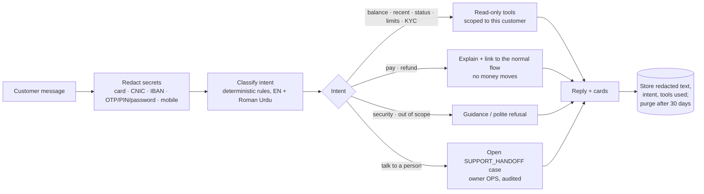

# 17. Conversational banking: the Paya Assistant (Theme 3)

**Goal.** Customers ask about their money in plain language, in English or Roman Urdu, and get an answer that is *true*: read from the ledger, not guessed. When they need a person, they reach one without repeating themselves.

**Bounds (ADR-011).**
- The assistant **cannot move money**.
- It sees **only the signed-in customer's** data.
- It stores **no secrets**.
- Its behaviour is **deterministic and versioned** (`assistant.v1`): there is no model to prompt-inject.

Code: `src/paya/assistant.py`, endpoints in `src/paya/api/ops.py`, UI in `web/src/wallet/Assistant.tsx`, console integration in `web/src/console/` (case transcript, AI operations, topology node). Tests: `tests/test_assistant.py` (C1–C10), browser run `docs/revamp/tools/assistant_e2e.cjs` (8/8).

## How a message is handled

| Intent | Examples | What happens |
|---|---|---|
| BALANCE | "What's my balance?", "mera balance kitna hai" | Available, ledger and reserved balances from the ledger |
| RECENT | "show my recent payments" | Last 5 movements as cards |
| TXN_STATUS | "did PAYA-…-ABC123 go through?", "did my payment to Chai Junction go through?" | Finds the payment by reference, else by merchant name, else the latest; explains the state in plain words; links to the detail page |
| WHY_DECLINED | "why was it declined?" | The plain reason (KYC, limit, balance, rail). **Screening reasons are never revealed** (no tipping off) |
| LIMITS, KYC | "what's my limit?", "am I verified?" | From the customer record |
| PAY | "send 500 to Ali" | "I can't send money from chat" + a link to scan and authorise |
| REFUND | "refund my last payment" | Explains automatic review after 15 min and two-person reversals; offers a person |
| SECURITY | "someone asked for my OTP" | Paya never asks for PIN, OTP or password; offers a person |
| OUT_OF_SCOPE | "should I buy bitcoin?" | Polite refusal |
| HUMAN | "talk to a person", "shikayat" | One SUPPORT_HANDOFF case per conversation, owned by OPS, with an SLA |

## Controls

| Risk | Control | Proof |
|---|---|---|
| Chat moves money (by bug or manipulation) | No payment, posting, transition or reversal function is imported; actions are links to the confirmed flows | C4, C9 (source check), e2e "prompt-injection attempt" |
| Customer sees someone else's data | Every tool filters on the authenticated customer id; transcripts are only readable by their owner, or by staff with `cases:read` | C3, C8 |
| Secrets stored in chat logs | Redaction runs **before** classification and storage; only the *kinds* removed are kept | C5, e2e |
| Prompt injection | No LLM; deterministic intents; database text is treated as data | C4, e2e |
| Staff browse chats | Staff transcript reads are audited (`CHAT_TRANSCRIPT_READ`); the transcript is already redacted | C7, e2e |
| Tipping off | Decline reasons are mapped to plain causes; screening specifics are never shown | Code (`_reason`) |
| Abuse / flooding | 20 messages per customer per minute; 500 characters per message | `respond()` |
| Over-retention | Conversations idle for 30 days are deleted by the worker | `purge_expired()` |

## Limits

- Rules-based understanding is narrow: anything outside the patterns gets help options. Mission Control shows the "not understood" rate. An LLM could later rephrase answers from the **same tool results**, behind the ADR-008 guardrails, but only after the same kind of evaluation the triage agent passed.
- Roman Urdu coverage is keyword-based, not linguistic.
- The rate limit is in-process (resets on restart); production needs a shared limiter.
- Handoff creates a case; the actual call-back to the customer happens outside Paya.
