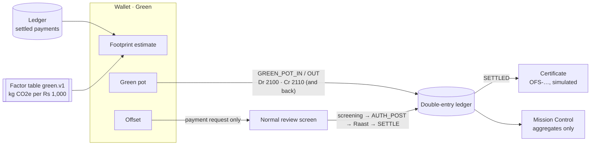

# 18. Sustainable and green banking (Theme 2)

**Goal.** Help customers see the environmental side of their spending and act on it, **without greenwashing and without a second money path**. Every number is either ledger fact (pot balances, settled offsets) or a clearly labelled estimate.

**Bounds (ADR-012).**
- The footprint is an **estimate** from settled payments × a versioned factor table (`green.v1`), always shown with its range and method.
- The green pot is the customer's **own money** on chart account **2110**, moved only by balanced, idempotent journals.
- An offset is an **ordinary Raast P2M payment**. Its certificate exists only after settlement and is labelled simulated.
- Staff see **aggregates only**.

Code: `src/paya/green.py`, API `src/paya/api/green_api.py`, wallet `web/src/wallet/Green.tsx`, console `web/src/console/pages/Green.tsx`, assistant intent `GREEN` in `src/paya/assistant.py`. Tests: `tests/test_green.py` (G1–G11). Browser run: `docs/revamp/tools/green_e2e.cjs` (14/14). Screenshots: `evidence/screenshots/green/`.

## The three features

| Feature | Source of truth | What the customer sees | What can't happen |
|---|---|---|---|
| Footprint | Settled/reconciled PAYMENT rows × `green.v1` | "about 7.2 kg CO2e · likely between 3.6 and 10.9 kg", by category, with the method | Held, pending, rejected or reversed payments counted; a figure without its factor version |
| Green pot | Ledger account 2110 (per customer) | Pot balance, moves, "Add money", "To wallet", "Add my round-ups (Rs 120)" | Overdrawing the wallet or pot; a double tap moving money twice; round-ups above what settled payments earned; an unverified wallet opening a pot |
| Offset | A normal PAYMENT to the synthetic project merchant (`MRC-0900`, category `CARBON_OFFSET`) | Rs 300 / 1,500 / 3,000 → the usual review → certificate once settled (Rs 3,000 per tonne, illustrative) | A certificate for an unsettled payment; another customer seeing or paying your offset request |
| Assistant | Same read functions | "what's my carbon footprint?", "mera green pot" | Chat moving money into the pot or paying an offset |

## Ledger

| Movement | Posting type | Debit | Credit | Reason code |
|---|---|---|---|---|
| Add money | `GREEN_POT_IN` | 2100 customer wallet | 2110 customer green pot | `GREEN_POT_DEPOSIT` |
| Add round-ups | `GREEN_POT_IN` | 2100 | 2110 | `GREEN_POT_ROUND_UP` |
| Back to wallet | `GREEN_POT_OUT` | 2110 | 2100 | `GREEN_POT_WITHDRAWAL` |
| Offset | the normal `AUTH_POST`, `SETTLE`, `FEE` | as any payment | | |

Pot movements are transactions of type `GREEN_POT_IN` / `GREEN_POT_OUT`, status `COMPLETED`, rail `INTERNAL`. They never touch 2150 or 1010, so the in-transit and settlement reconciliations are unaffected. Total customer liability = Σ2100 + Σ2110.

## Controls

| Risk | Control | Proof |
|---|---|---|
| Double submit or retry moves money twice | Mandatory Idempotency-Key (`POST /v1/green/pot/moves`); the UI sends once per dialog | G3; e2e "double-tapped deposit moves money once" |
| Overdraw / race with a payment | Same wallet row lock as payments, plus a pot lock; available-balance and pot-balance checks; Rs 500,000 pot limit | G4 |
| Ledger drift | One balanced journal per move; DB CHECK on types; integrity checks `no_negative_green_pots`, `green_pot_move_has_one_journal` | G2, G9; e2e |
| Greenwashing | Estimate label, ±50% band, method text, factor version; factors marked illustrative in Mission Control | G1; e2e |
| Fake offsets | Certificate only from a SETTLED payment; "No real carbon credit is retired" on screen | G7; e2e |
| Profiling by staff | `green:use` is CUSTOMER-only; Mission Control has portfolio aggregates only | G8; e2e |
| Green module grows a money path | Source check: no rail import, no dispatch, no house accounts, exactly one `ledger.post` (customer 2100 ↔ 2110) | G10 |
| Chat moves money | GREEN intent is read-only and points to the Green screen | G11 |

## Limits

- The factors are **illustrative**. A real product needs a licensed EEIO dataset, mapping to the Pakistan Green Taxonomy, and periodic review.
- Spend-based estimates cannot tell a bus ticket from a taxi in the same category. Category granularity limits accuracy.
- The offset project, its price and its certificates are **simulated**. A real offering needs a registry-backed partner and its own agreements and disclosures.
- Green investments are out of scope (an EMI does not offer investment products).
