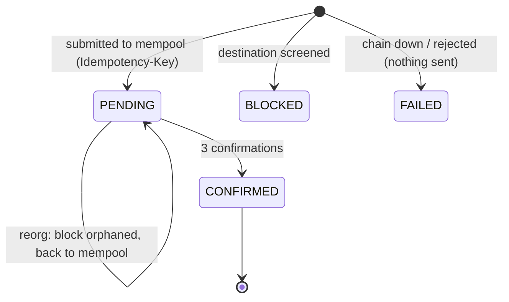

# 20. Stablecoin sandbox (Theme 5): off by default

**Goal.** Show how Paya would integrate a tokenised-money rail (wallets, compliance, merchant acceptance, finality and reconciliation) **without offering a stablecoin**. Under current Pakistani rules (virtual assets are not legal tender; the Virtual Assets Act 2026 and PVARA regulations) Paya may not offer stablecoin payments. So the sandbox is a switched-off prototype with worthless test tokens on a simulated chain (ADR-014).

**Switch:** `PAYA_STABLECOIN_SANDBOX=true` (default `false`). When off, every endpoint answers `404 FEATURE_DISABLED`, the worker does nothing, the wallet shows no tile, and Mission Control says why.

Code: `src/paya/chain.py` (simulated chain, schema `chain`), `src/paya/tokens.py`, API `src/paya/api/sandbox_api.py`, wallet `web/src/wallet/Sandbox.tsx`, console `web/src/console/pages/SandboxPage.tsx`. Tests: `tests/test_sandbox.py` (SC1–SC12). Browser run: `docs/revamp/tools/sandbox_e2e.cjs` (3/3 off, 10/10 on). Screenshots: `evidence/screenshots/sandbox/`.

## What the theme asks for, and what we built

| Theme 5 asks for | Built | Not built, and why |
|---|---|---|
| Wallets | Custodial sandbox address per tier-2 customer, after an explicit "no value" acknowledgement | Real key custody (HSM, MPC); it needs regulator approval and a custody design |
| Compliance | Address screening (block, Compliance case, audit), per-transfer and daily limits, travel-rule beneficiary data, idempotent transfers | Chain-analytics vendor screening; the list is synthetic |
| Merchant integrations | Two synthetic merchants accept test tokens; payment counts at finality | Merchant settlement or conversion to rupees (not permitted) |
| Savings | **No** | Yield on stablecoins is not an EMI product; no returns are mentioned |
| Payments | Test transfers with finality and reconciliation | A live payment method (not permitted) |

## Finality and reorgs

- **Spendable** = confirmed (≥3) balance on the chain − Paya's pending outgoing transfers.
- **Reconciliation** (`token_transfers_match_chain`): every CONFIRMED record must still be included on the chain with the same addresses and amount, at depth ≥3.
- **No rupees** (`sandbox_tokens_never_in_rupee_ledger`): no journal may reference a token transfer.
- **Source of truth:** the chain, for token balances. Paya's `token_transfers` table is the audit and reconciliation mirror.

## Chain chaos (Mission Control, `chaos:control`)

| Mode | Behaviour | What Paya does |
|---|---|---|
| NORMAL | A block every 2 s | Confirms at depth 3 |
| CONGESTED | Empty blocks | Transfers stay PENDING with 0 confirmations |
| REORG | The next block orphans the tip; its transactions go back to the mempool | Confirmations drop; nothing shown as final too early (SC6) |
| DOWN | Node refuses connections | Transfer recorded FAILED, "nothing was sent"; nothing reserved (SC10) |

## Limits

- The chain is simulated: no signatures, gas, mempool fees or network.
- Faucet issuance is the only token source. That is deliberate: Paya does not issue value.
- A real integration needs an SBP- or PVARA-approved instrument and partner, regulated custody, chain analytics, and its own reconciliation agreements.
