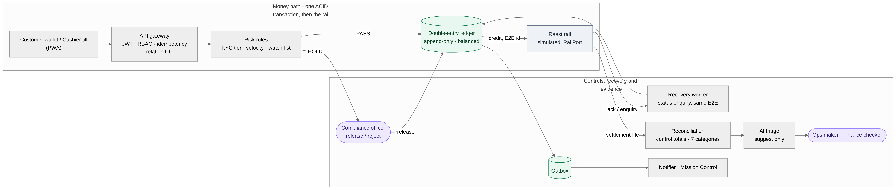

**Paya** makes a Raast QR payment *provably* paid. The cashier sees **PAID** only when the rail has confirmed and a double-entry ledger has posted settlement. A customer's screen, a screenshot or a notification is never treated as proof. Paya is a **technology service provider** to a licensed partner EMI (synthetic). It holds no funds and no licence. **This is an academic prototype on synthetic data. No real money moves, the Raast rail is simulated, and the internal architecture is a proposed reference design, not a claim about any firm.**

## Journey and scope

**Journey (brief §1: merchant payment, plus refund/reversal):** the cashier creates a dynamic QR. The customer pays from a partner-EMI wallet. The flow passes through the gateway (auth, idempotency, correlation), then KYC/AML/fraud rules, then authorisation (hold), then ledger posting, then the Raast credit, then settlement and fee posting, then notifications, then next-day reconciliation against the rail file, then finance reporting.

| In scope (built and tested) | Out of scope (stated) |
|---|---|
| Dynamic QR; idempotent pay; KYC tier, velocity and watch-list rules with compliance hold; reversal with maker-checker; simulated Raast with 9 failure modes; settlement-file reconciliation; AI triage of breaks; live operations view | Cards and chargebacks; real NADRA/biometrics; real bank, EMI or Raast connectivity; post-settlement refunds; production HA |

## Systems (C4 containers) and systems of record

{width=100%}

*Modular monolith (ADR-001): one API container (gateway, payments, risk, ledger, reconciliation, events, AI) plus a recovery worker, PostgreSQL 16, and a simulated Raast rail in its own schema. Full C4 views are in the dossier.*

| Truth | System of record | Never truth |
|---|---|---|
| Money | Ledger (`journals`, `ledger_entries`): append-only, balanced | UI status, notifications, screenshots |
| Payment state | Transaction service and status history | Client-reported status |
| What the rail did | Raast (simulated `rail.*`), compared by reconciliation | — |

## Constraints

- **Cost:** PKR 0. Everything is open source and runs locally (Docker Compose).
- **Ethics:** synthetic data only; no CNIC, biometric, card or account data.
- **Access:** no public Raast API, so the rail is a port with a simulator (ADR-005).
- **Regulation:** PVARA/SBP rules exclude stablecoin payments, so that work is sandbox only.
- **Team:** one semester; a modular monolith rather than microservices (ADR-001).

## Key assumptions (risk-rated)

| # | Assumption | Risk if wrong |
|---|---|---|
| A1 | Cashiers often confirm payment from the customer's screen | **Highest:** weakens the problem; merchant interviews needed |
| A2 | The partner EMI holds the wallets and acts as MSP | Medium |
| A3 | Raast offers status enquiry and treats a repeated end-to-end id idempotently | Medium |
| A4 | A daily settlement file with control totals; T+1 | Low |

## Critical controls

| Risk | Control | Proof |
|---|---|---|
| Double debit on retry or second tap | Idempotency key; one live payment per QR; `UNIQUE(txn_id, posting_type)`; wallet row lock | S2, S11, concurrency test |
| Timeout mistaken for failure | Timeout → PENDING → status enquiry; resend only the same E2E id on NOT_FOUND; 15 min → human | S4, ADR-006 |
| Wrong or edited ledger | Balanced-journal trigger; append-only triggers; corrections are linked journals | ledger tests |
| Insider reversal | Ops requests, Finance approves; DB `CHECK maker ≠ checker`; denial audited | S6, S6b, S6c |
| Sanctions or fraud | Rules → HOLD; no money moves until Compliance decides | S7 |
| Settlement mismatch | Control totals; duplicate-file refusal; 7 break categories with owners; 12 integrity checks | S10, S13 |
| AI over-reach | Suggest-only agent; abstains; owner-only review; no money-moving code (source-checked) | AI tests, evaluation |

## Non-functional requirements (targets and **measured**)

| NFR | Target | Measured (one machine, prototype) |
|---|---|---|
| Pay latency | p95 ≤ 1 s at 10 concurrent | 792 ms (84 ms at c=1) |
| Time to authoritative PAID | p95 ≤ 3 s | 1.8 s (0.1 s at c=1) |
| Duplicate financial effect | 0 | 0 / 400, incl. duplicate-ack storm |
| Recovery (RTO / RPO) | API 5 min; committed data RPO 0 | 1.3 s after SIGKILL; 0 lost |
| Reconciliation | every break owned within 24 h | automatic owner and SLA |
| Reproducibility | one command; CI | `make up`, `make verify`; CI green |
| AI safety | 0 unsafe autonomy | 0% (94.1% accuracy on acted cases) |

**Recommendation: CONDITIONAL GO.** Proceed to a synthetic pilot subject to five conditions: a partner sandbox behind `RailPort`; MFA, token revocation and rate limits; separate DB roles; merchant validation of A1; and LLM evaluation before enabling one.
