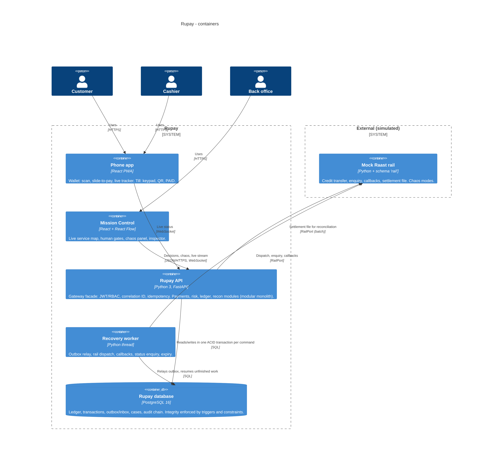
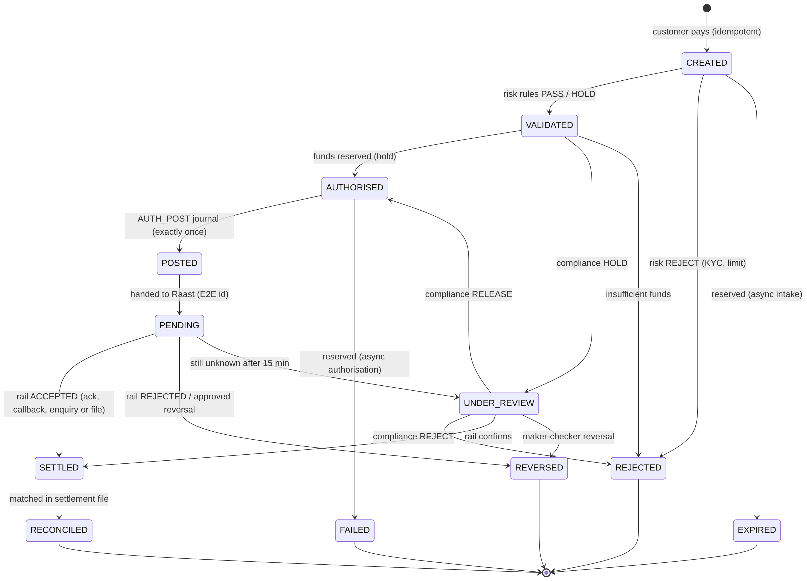
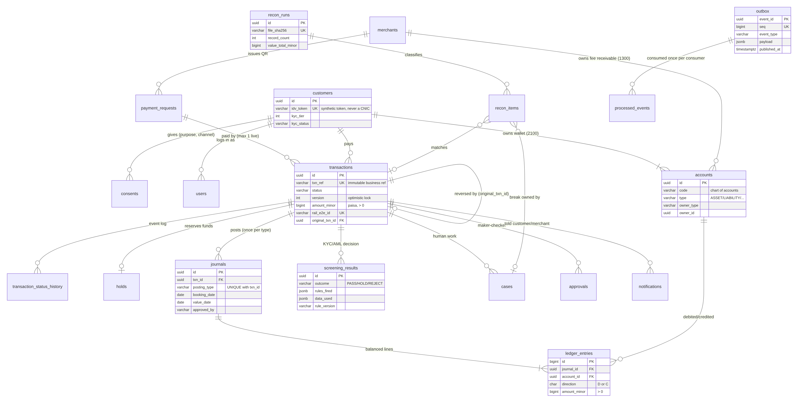

## 1. Executive summary

Pakistan's instant payment system has crossed into everyday commerce. SBP's annual reports show Raast person-to-merchant payments growing from 4.9 million to about 180 million transactions in a year. Yet the moment of truth at a shop counter is still often a cashier glancing at a customer's phone. **Rupay** is a payment-assurance platform for that moment. The cashier sees *PAID* only when the rail has confirmed and a double-entry ledger has posted settlement. Every exception that follows (timeouts, duplicates, rejections, missing settlement lines) becomes owned, evidenced work rather than a spreadsheet.

Rupay is designed as a **technology service provider** to a licensed partner EMI, which is synthetic in this prototype. It never holds funds or claims a licence. The implemented journey is the brief's *merchant payment* with its linked *reversal*. It runs from channel to gateway, then identity and AML controls, ledger, rail, posting, settlement, reconciliation, notification and finance reporting.

The prototype runs locally with one command. It is covered by 150 automated backend tests (the ten required scenarios plus concurrency, security, AI, migration and theme tests, all run as a data-only database role), by browser acceptance runs, and by GitHub Actions continuous integration. It has been measured:

- **Recovery:** after a forced crash with payments in flight, the API was healthy in 1.3 s, and every payment settled exactly once within 6 s.
- **Load:** 400 payments, including a storm of duplicate acknowledgements, with zero duplicate settlements.
- **AI:** a bounded triage agent reaches 94.1% accuracy on the cases it acts on, with zero unsafe autonomy.

Two of the semester's thematic areas are also built on the same core: **digital onboarding and KYC**, and **conversational banking** (section 11).

We recommend a **conditional go**. The conditions, stated in section 12, are the controls a real pilot would need and a classroom prototype cannot provide.

## 2. Context, journey and scope

**Problem.** Three gaps motivate the design.

1. *Confirmation.* A customer's success screen, an SMS or a screenshot is not settlement, and SBP's own P2M instructions require providers to give merchants real-time confirmation or rejection.
2. *Reconciliation.* Settlement credits arrive in bulk files with no link to orders, so small merchants reconcile by hand.
3. *Uncertainty.* Networks time out, acknowledgements duplicate, and files omit lines.

Week 9's lecture is blunt about the consequence: *"a user-facing success screen may be earlier than settlement finality."*

**Journey.**

1. The cashier creates a dynamic QR for an order.
2. The customer scans it and slides to pay.
3. Rupay validates the request and its idempotency key, screens it against KYC tier limits, velocity and a synthetic watch-list, reserves the funds, and posts a balanced journal that moves the money from the customer's wallet into *payments in transit*.
4. Rupay sends the credit to the Raast rail with a unique end-to-end (E2E) identifier.
5. When the rail confirms, Rupay posts settlement and the merchant fee, the till shows *PAID* and speaks the amount, and both parties are notified.
6. The next day, Finance imports the rail's settlement file and reconciles it against the ledger.

**Scope.** In scope:

- the full journey above;
- compliance holds;
- maker-checker reversal;
- nine simulated rail failure modes;
- reconciliation with owned exception cases;
- an AI triage agent;
- an operations console, *Mission Control*;
- digital onboarding with KYC checks, and a read-only conversational assistant (section 11).

Out of scope, and stated as such: cards and chargebacks; real identity verification (NADRA) or certified liveness; connectivity to any real bank, EMI or Raast endpoint; refunds after settlement; production high availability.

**Ethical boundaries.**

- All people, merchants, aliases and IBANs are synthetic, and there is no column in which a real CNIC could be stored.
- We never probed, scanned or load-tested any real payment service. All failure testing targets our own simulator.
- The design is presented as a proposed reference architecture, not a description of any company.

**Assumptions.** The riskiest is that cashiers commonly confirm payment from the customer's screen (A1). We found no Pakistan-specific study of this, so merchant interviews are a condition of our recommendation. The others concern the partner's role (A2), Raast's status-enquiry and E2E-idempotency behaviour (A3), and a daily settlement file with control totals (A4). Each is rated and listed in the gate pack with how it would be validated.

## 3. Architecture and key decisions

{width=80%}

The system is a **modular monolith** (ADR-001). One API process hosts distinct bounded contexts: gateway, payments, risk and compliance, ledger, rail integration, reconciliation, events, audit and AI. Each owns its tables and talks to the others through narrow functions.

We evaluated microservices against Week 5's six integration dimensions. With one team, one semester and one critical consistency boundary, a single process won on three counts:

- validation, authorisation and posting can share one ACID transaction;
- every log line carries one correlation ID;
- one worker can resume all unfinished work after a crash.

The seams are deliberate. The rail sits behind a `RailPort` interface, and the event outbox decouples producers from consumers, so splitting a context out later does not require redesign.

The brief asks for explicit **systems of record**. We applied Week 1's record / engagement / intelligence classification at attribute level:

- The **ledger** is the only source of internal financial truth.
- The **transaction service** owns state.
- The **rail** is authoritative only for what *it* did, and its records live in a separate schema so that reconciliation compares two independent systems.
- Notifications, screens and Mission Control are engagement and intelligence layers. They read truth and never create it.

We recorded this as architecture principle P1: *no UI, notification, screenshot or external message is truth until posted or matched against the ledger.*

Nine architecture decision records capture the main choices with their alternatives:

| ADR | Decision | Main alternative rejected and why |
|---|---|---|
| 001 | Modular monolith; synchronous commands, asynchronous events, batch file | Microservices: distributed transactions for no current benefit |
| 002 | Append-only double-entry ledger in PostgreSQL | Mutable balance column: no history, lost-update risk |
| 003 | Idempotency in PostgreSQL at two layers | Redis: a second store whose failure could re-allow duplicates |
| 004 | Transactional outbox and inbox; broker later | Publishing directly to a broker: a commit could lose its event |
| 005 | `RailPort` with a simulated Raast rail | Wallet merchant sandbox: gated and not Raast P2M |
| 006 | Timeout means PENDING, never FAILED | Fail fast and refund: risks paying both customer and merchant |
| 007 | Row locks plus database constraints | Serialisable isolation everywhere: harder to reason about |
| 008 | AI triage rules-first, LLM optional, suggestion-only | Hosted LLM: data leaves the machine; free tiers unstable |
| 009 | One PWA plus a live stream for Mission Control | Grafana only: cannot show human gates or explain a payment |
| 010 | Onboarding: machines approve clear cases, people decide the rest; no biometric data at rest | Auto-reject on face non-match: unfair under biometric error rates |
| 011 | Assistant: deterministic, read-only, cannot move money | LLM with payment tools: one manipulated message could move money |

## 4. Transaction model and integrity

{width=74%}

The transaction state machine uses the vocabulary of the Week 9 lecture, mapped to the brief's states:

`CREATED → VALIDATED → AUTHORISED → POSTED → PENDING → SETTLED → RECONCILED`

- `UNDER_REVIEW` absorbs both compliance holds and uncertainty that has lasted too long.
- `REVERSED` is reached only through a compensating journal.
- Every transition is a single database operation that does three things together: an optimistic-locked update (`WHERE status = expected AND version = v`), an append to an immutable status history, and an event written to the outbox.
- A transition not in the table raises an error. For example, there is no way from CREATED to SETTLED without evidence.
- For each state we specified the owning component, the evidence stored, the timeout, the retry rule and the reversal rule, as the lecture requires.

**Idempotency works at four layers**, because each protects against a different failure:

1. **HTTP layer.** An `Idempotency-Key` is stored with a hash of the request and the response. A client retry after a lost response gets the original answer with `Idempotent-Replayed: true`. Reusing a key with a different body is refused.
2. **Business layer.** The Week 9 workshop exposed a harder case: the customer taps again from a fresh app session, so the key is *new*. A partial unique index allows only one live payment per QR, and the second tap is told which payment to follow.
3. **Ledger layer.** `UNIQUE(txn_id, posting_type)` makes every posting happen at most once, whoever attempts it.
4. **Rail layer.** A resend reuses the same E2E identifier, which the rail treats idempotently.

**Uncertainty is a first-class state** (ADR-006).

- A rail timeout does not mean failure. The rail may have paid. Marking the payment failed and refunding the customer is how a customer and a merchant both end up paid, the exact trap in the lecture's outage scenario.
- On timeout, a payment stays PENDING with its money visibly in *payments in transit*.
- A recovery worker *asks* the rail at 5 s, 15 s, 45 s, 2 min and 5 min. It resends only when the rail confirms it never received the credit, and then with the same E2E identifier.
- After fifteen minutes the payment moves to UNDER_REVIEW with a case owned by Operations. Any reversal requires an Operations maker and a different Finance checker.
- Throughout, customers and cashiers see "Sent – awaiting confirmation". They never see "Paid" before settlement.

**Partial failures and duplicates.**

- If the rail rejects a payment after the customer was debited, a new REVERSAL transaction linked to the original posts the compensating journal. The original debit stays in the ledger as evidence.
- Duplicate acknowledgements and redelivered events are absorbed at three points: consumer inboxes keyed by event ID, a row lock under which a repeat answer is a no-op, and the posting constraint.
- A circuit breaker opens after three rail failures and refuses *new* payments before any debit. A customer is told immediately rather than left with a half-finished payment.

**Concurrency** (ADR-007) was hardened by evidence rather than assumption.

- Our first load test found that the API's post-response dispatch and the recovery worker could act on the same payment at once.
- The database constraint prevented any double posting, so no money was wrong. But the refused insert surfaced as an unhandled error and dropped client connections.
- The fixes:
  - every path that applies a rail answer takes a row lock;
  - the worker's first send became an atomic claim;
  - get-or-create operations were serialised;
  - background tasks can no longer raise into the server.
- A regression test that races dispatches, callbacks and enquiries now passes repeatedly. The load test re-run showed zero errors.
- Our conclusion is that constraints are the last line of defence and must not be the normal control path.

## 5. Integration contracts

Following Week 5, one journey uses several patterns, each chosen for its latency, coupling, consistency and recovery profile:

| Exchange | Pattern |
|---|---|
| Customer pays; cashier creates a QR | **Synchronous API commands** |
| State changes | **Events** through a transactional outbox |
| Rail calls | **Request/response through a port**, with an 8-second timeout |
| Rail acknowledgements | **Asynchronous messages** consumed through an inbox |
| Settlement file | **Batch file** with a control trailer |
| Screens | **WebSocket stream**, display only |

The synchronous contract is the generated `openapi.json`: 55 operations with roles, a single error shape (stable machine-readable code, human message, recovery hints, correlation ID) and documented status codes. Paying returns `202 Accepted`, not `200 OK`: the money is in transit, not settled, and the contract says so.

The asynchronous contract is a set of JSON Schemas for the four event types. Every envelope carries:

- an event ID (the de-duplication key);
- a sequence number;
- a type and schema version;
- the aggregate (transaction) ID;
- a correlation ID;
- a timestamp.

These are the minimum fields the brief lists. Adding an optional field is compatible; renaming or re-meaning one requires a new schema version.

A Bruno collection of sixteen requests exercises the contract end to end, and every assertion passes. It covers login, QR creation, payment, same-key replay, the second-tap refusal, settlement detail, balanced journals, reconciliation, duplicate-file refusal, integrity checks, a refused cashier and a hidden foreign reference.

## 6. Data, ledger and reconciliation

{width=92%}

The data model covers every entity the brief lists: customer, wallet/account, transaction, ledger entry, event, KYC/AML decision and reconciliation. It adds holds, cases, approvals, notifications and the audit chain. The full ERD and table dictionary are **generated from the code**, so documentation cannot drift from implementation.

Four rules keep the money honest:

- **Integer paisa.** Money is stored as integer paisa; floating point never touches an amount.
- **Derived balances.** Balances are computed from entries, never stored.
- **Database-enforced integrity.** PostgreSQL enforces it directly:
  - a deferred trigger rejects any journal whose debits and credits differ;
  - triggers reject `UPDATE` and `DELETE` on journals, entries, status history and audit;
  - partial unique indexes enforce one live payment per QR and one reversal per original;
  - a CHECK constraint forbids the maker of an approval from being its checker.
- **Corrections are new journals**, each with a reason, actor, approver and rule version. The Post Office Horizon evidence studied in this course shows why silent correction is unacceptable.

**Posting rules.** A PKR 2,450 payment posts:

| Journal | Debit | Credit | Amount |
|---|---|---|---:|
| AUTH_POST | Customer wallet (2100) | Payments in transit (2150) | 2,450.00 |
| SETTLE | Payments in transit (2150) | Settlement account at the sponsor bank (1010) | 2,450.00 |
| FEE | Merchant fee receivable (1300) | Fee income (4100) | 12.25 (synthetic 0.50%) |

A rail rejection posts a reversal: debit in transit, credit the wallet. Keeping uncertain money in a clearing account makes uncertainty measurable. Its balance must always equal the sum of payments awaiting the rail, and that is checked continuously. Worked examples in the evidence pack were generated by running five journeys on a fresh database and exporting the real postings.

**Reconciliation** implements the Week 9 four-layer stack.

- **Financial layer.** The rail's settlement file is first checked against its trailer (record count, value total, SHA-256), and a file whose hash was seen before is refused. Lines are then matched to internal payments by E2E identifier and classified into seven categories:

| Category | Owner |
|---|---|
| Matched | none |
| Missing externally | Operations |
| Missing internally | Finance; a claim journal is posted |
| Duplicated externally | Operations |
| Amount mismatch | Finance |
| Status mismatch | Finance |
| Timing difference | none; expected in the next file |

  Every break becomes a case with an owner and an SLA. A later file that resolves it closes the case automatically with evidence.
- **Technical, operational and exception-management layers.** Fourteen continuous integrity checks (two added for onboarding) verify, for example:
  - that the outbox relay is not stalled;
  - that no settled payment left the customer uninformed;
  - that the till never shows PAID without a settled payment;
  - that the trial balance balances;
  - that no wallet is negative;
  - that no break is unowned or overdue.

Testing found one gap we then closed. If the only new payment in a day is the one the rail omitted, the rail's file is byte-identical to the previous one and is correctly refused as a duplicate, so nothing would flag the missing payment. A check for settled payments still unreconciled after D+1 now catches it.

## 7. Security, KYC/AML and access governance

**Access control.**

- Access follows least privilege across eight roles: customer, cashier, merchant administrator, operations, compliance, finance, system administrator and auditor.
- Each user holds exactly one role, so a person can never accumulate maker and checker rights. This makes the joiner-mover-leaver segregation-of-duties conflict structurally impossible.
- Operations *requests* reversals. Finance *approves* them, and must be a different person: enforced by the application, the role matrix and a database CHECK. A refused self-approval is still recorded; we found and fixed a bug where that audit row was rolled back with the refused action.
- Only Compliance can release or reject a hold.
- The system administrator has no financial permission.
- A customer requesting another customer's transaction receives 404, not 403, so references are never revealed.

**KYC/AML/fraud screening** is deterministic, versioned configuration (Week 6: configure before customise):

- unverified customers are rejected;
- tier limits apply;
- five or more payments in ten minutes trigger a hold;
- a synthetic watch-list match triggers a hold;
- high-risk customers making large payments trigger a hold.

Every decision stores the rules fired and the data used. A held payment moves no money: its ledger is empty until a compliance officer decides, and the decision and reason are recorded. This follows the Week 3 control principle that no account or payment proceeds before mandatory controls pass, and that high-risk cases cannot bypass human review.

**Authentication and evidence.**

- Passwords are hashed with Argon2id. Tokens expire in 60 minutes. Five failed logins lock an account for fifteen minutes.
- Responses carry security headers and are never cached.
- Logs are scrubbed of secrets by key name.
- The audit log is a **hash chain**: each row stores the hash of its predecessor. Verification recomputes the chain and names the first broken row. Logins, refusals, compliance decisions, reversal requests and approvals, chaos changes, AI suggestions and human reviews are all recorded.

**Threat model.** A STRIDE analysis over the data-flow diagram identifies fifteen threats, each with preventive, detective and recovery controls and an honest residual rating. We prioritised two attack paths: double spending by retry or race, and an insider reversing a payment alone. Both are mitigated and tested.

**Dependency audits** found published vulnerabilities in our web framework's Starlette version, the frontend router and the test runner. We upgraded all three. Two moderate router advisories that need a major-version upgrade are compensated by accepting only a well-formed UUID from a scanned QR code, and are tracked as debt.

## 8. Resilience

We catalogued thirteen failure modes, each with detection, automatic response, human step and proof. Recovery objectives are justified in business terms:

| Component | RTO | RPO | Why |
|---|---|---|---|
| Payment API | 5 minutes | n/a | Cashiers can fall back to other methods briefly; wrong money is the harm to avoid |
| Ledger | 30 minutes from dump | **0** for committed transactions while the volume survives; ≤ 24 h if the volume is lost (single node) | Losing a committed posting is unacceptable |
| In-flight payments | Correct and explained within 15 minutes | 0 | Matches the review window after which a human owns them |

A scripted drill against the real containers measured:

1. **API killed with SIGKILL** while three payments waited behind a "lost request" rail fault. The API was healthy in **1.3 s**. The worker resumed from the database and all three settled **exactly once within 6.0 s**, with three rail records, no duplicates and all integrity checks passing. A fourth payment attempted during the fault had been refused by the circuit breaker before any debit.
2. **Database restart** under load. Service resumed in **0.7 s**.
3. **Backup and restore** into a fresh database. Identical account balances, with the integrity triggers restored.

Reproducibility is part of resilience. A fresh clone from GitHub passes every test against an empty database, and CI runs tests, evaluation, dependency audit, web build and image build on every push. The check also found that the database container lacked a restart policy, so after a host restart the API crash-looped. That would have been a failure on the morning of a demo; it is fixed.

## 9. Observability

**Logs.** Every request produces one JSON log line with its correlation ID, route, status and duration. Business telemetry from risk, ledger, rail, reconciliation and AI is logged with the transaction reference, and with the correlation ID when inside a request. A single payment can therefore be reconstructed from logs; the evidence pack includes such a trace.

**Metrics.** `/metrics` exposes, in Prometheus format:

- payments by state;
- money in transit;
- open cases;
- circuit-breaker state;
- outbox backlog;
- per-route request counts and latency histograms.

**Mission Control** is the operations console. An operator signs in as a named staff member, and every action runs as that person and is checked by the server. Its pages cover an overview of payments, rail and human work; transaction search with a full evidence drawer; a system topology that separates static architecture from observed telemetry (it never shows a component as healthy merely because it is green); an event stream from the outbox; cases and maker-checker approvals; KYC review; reconciliation; AI operations; a rail lab that injects real failures; and the audit log. Nothing on it is scripted: an automated rehearsal of the demo asserts every on-screen claim against the API.

**SLOs.** Eight service-level objectives pair business meaning with measured values. They are stated as one-machine prototype numbers, not production capacity:

- payment initiation p95 under 1 s at ten concurrent customers (measured 899 ms after the security hardening; 792 ms before);
- authoritative status p95 under 3 s (2.1 s);
- zero duplicate financial effects (0 of 400);
- no uncertain payment older than fifteen minutes without an owner.

The load test also established an honest capacity limit. A payment costs about 70 ms of service time (60 ms before every request began checking its server-side session), so one Python process saturates near fourteen payments per second, and higher concurrency adds queueing. The scaling path is several API processes, a separate worker and a broker; the row locks already make concurrent workers safe.

## 10. Responsible AI governance

We chose **reconciliation-exception triage** over fraud triage or a chatbot. Breaks are where operations time goes, and a wrong suggestion costs time, not money. The agent reads a minimum-data context (case, transaction status and amount, the rail's status, the settlement time, whether a compliance case is linked), and every fact carries an evidence reference. It returns a category, a hypothesis, an owner, a next action from a nine-item allow-list, its evidence and a confidence.

Governance is enforced structurally, not by promise:

- **No money-moving code.** The agent's modules import no posting, reversal, approval or state function, and a test parses their source to prove it.
- **Abstention.** Following the Week 4 list, it abstains below 0.75 confidence, when the rail's status is unknown, above PKR 100,000, and whenever a compliance case is linked.
- **Human decision.** Only the case owner may accept or override a suggestion. An override requires a reason. Accepting changes nothing financially.
- **Audit.** Every suggestion is stored with its engine, a hash of the exact prompt context, its evidence and latency, and appears in the audit chain.
- **Fallback.** A deterministic rules engine is the default. An optional local LLM is used only if its output passes the allow-list, schema and evidence checks; otherwise the rules engine answers.
- **Prompt injection.** Rail free text is passed as quoted data, never as instructions.

**Evaluation.** We built 120 labelled cases in which the true cause is chosen first and the observable evidence is generated with noise, traps and injected instructions. Results:

| Metric | Result |
|---|---|
| Accuracy on cases acted on | 94.1% |
| False reassurance | 3.5% |
| Unsafe autonomy | 0% |
| Policy violations | 0 |
| Correct or handed to a human | 95.8% |
| Injection cases handled safely | 20 of 20 |

The report names the main error: an omission that settled near cut-off looks like a timing difference. Live metrics (acceptance, override and abstention rates, fallbacks, audit completeness) are exposed for monitoring. No LLM was evaluated in this environment, and one must pass the same evaluation before being enabled.

## 11. Product experience and thematic extensions

**Rupay 2.0.** A product review found that the first interface used one neon green for everything, so "rail accepted" looked the same as "settled". The console also hid who was acting. Both surfaces were rebuilt on one design system:

- a light, calm wallet and a dark, dense console, built from shared tokens;
- self-hosted fonts, so the PWA works offline;
- a single status language in which **green means confirmed by the ledger**; uncertainty is shown as *processing*, never as success.

The payment result is driven only by server status. A browser test samples the screen and the database together and fails if the screen says "Paid" before the ledger has settled. Accessibility was evaluated against WCAG 2.2 AA: zero automated violations on twenty-three screens, and computed contrast for every colour pairing. The backend gained read-only operations endpoints (search, time series, event history, reconciliation lines, audit log) and one control, case assignment, which moves no money. The financial modules were not modified.

**Theme 1: digital onboarding and KYC (ADR-010).** A customer opens a tier-1 wallet in about two minutes:

- consent;
- a synthetic SPECIMEN identity card with a signed code;
- a randomised head-turn liveness challenge;
- a face match using permissively licensed models (YuNet, MIT; SFace, Apache 2.0);
- a simulated identity registry;
- fuzzy watch-list screening;
- one-identity-one-wallet checks and device location.

Machines approve only when every check passes; **only people reject**. An unanswered registry call or a missing model becomes a referral, never a decision. Approving a possible sanctions match needs two different compliance officers, enforced by the service and by a database constraint. The applicant is never told that screening caused a referral. Photos and face templates exist only in memory for one request: a test scans every column of the database for image data.

**Theme 3: conversational banking (ADR-011).** The Rupay Assistant answers questions about the customer's own wallet in English and Roman Urdu, from the ledger: balance, recent payments, a payment's status and why, limits, and verification. It is deliberately deterministic and read-only. It imports no payment or posting function (a test reads its source), so "send money" or "refund me" returns an explanation and a link into the normal review-and-authorise flow. Card numbers, CNIC-like numbers, IBANs and OTPs are redacted before a message is classified or stored. "Talk to a person" opens an owned support case, and staff reads of a transcript are audited.

**Theme 2: sustainable and green banking (ADR-012).** The wallet shows a spend-based *estimate* of the carbon linked to the customer's settled payments, with its range, method and factor version (`green.v1`, illustrative). A green pot ring-fences the customer's own money on chart account 2110: each move is one balanced journal against their wallet (2100), under the payment's own row lock, balance checks and idempotency key, and round-ups are capped at what settled payments earned. An offset is an ordinary Raast payment to a synthetic project, so screening, recovery and reconciliation apply unchanged; its certificate exists only after settlement and says no real credit is retired. Staff see aggregates only, and two integrity checks were added.

**Theme 4: the super app (ADR-013).** A Services tab adds bills, mobile top-up, a marketplace with a merchant-funded offer, and monthly micro-takaful from synthetic partners. A partner is just a merchant: checkout creates a server-priced payment request that the customer authorises on the normal review screen, so there is no new money path (a test reads the module's source). Order status ("bill paid", "cover active") is read from that payment, so it cannot run ahead of the ledger. A bill can be paid only once; partners receive only consented fields, recorded on the order and integrity-checked; Compliance can suspend a partner (audited). Investments are not offered. **Send to a bank (ADR-018)** reuses the same money path; the account-name lookup is a simulated directory of synthetic people, and only a masked number is kept.

**Theme 5: stablecoin sandbox (ADR-014).** PVARA/SBP rules do not permit stablecoin payments for Rupay, so this prototype is **off unless a server flag is set**. Verified customers who acknowledge the tokens are worthless get faucet test tokens on a simulated chain (mempool, blocks, reorgs, outages). Transfers are screened, limited, travel-rule-checked and idempotent; they count only at three confirmations and are reconciled against the chain. No token movement can reach the rupee ledger (an integrity check). Savings are not built: yield is not an EMI product.

All five themes reuse the integrity core: cases, roles, the ledger, the audit chain and the live stream. Themes 1 and 3 move no money; Themes 2 and 4 move it only through the ledger's existing controls and the one payment path; Theme 5 moves only worthless test tokens and is off by default. They add controls, not exceptions to them.

## 12. Limitations, risks and recommendation

**Limits we accept for a prototype, each with an owner in the technical-debt register:**

- one API process caps near sixteen payments per second;
- access tokens live in browser storage rather than httpOnly cookies, and there are no MFA recovery codes;
- the simulated rail has no message signing, and its behaviour rests on assumptions A3 and A4 rather than Raast specifications;
- the AI's LLM path is untested against a real model;
- onboarding liveness is a basic active check, not certified presentation-attack detection, and the face recogniser has not been evaluated for accuracy or fairness on consented real faces;
- the assistant understands a fixed set of intents only;
- the evidence is synthetic, including the core user problem (A1).

**Reflection.** What the project demonstrates most strongly is the course's central claim: enterprise systems are operating-model architectures. Rupay's value is not in any single screen. It is in decisions that connect process, data and control:

- what counts as paid;
- who owns a break;
- when a machine must stop and a person must decide;
- what evidence proves it happened.

Several of our best design improvements came from evidence rather than foresight: the load-test race, the identical-file gap, the lost denial audit and the missing restart policy.

**Recommendation: CONDITIONAL GO** for a controlled pilot on synthetic or partner-sandbox data, subject to:

1. a licensed partner sandbox behind `RailPort`;
2. merchant and cashier interviews validating assumption A1;
3. any LLM passing the same evaluation before use.

Met since the review: separate database roles (ADR-015), rate limiting (ADR-016), and instant token revocation with staff two-step verification (ADR-017).

# Appendices

## Appendix A: Required scenarios and their evidence

| Brief scenario | Test(s) | Live demo scene |
|---|---|---|
| Normal success | `test_s1_normal_success_end_to_end` | Scene 1 |
| Client retry after timeout | `test_s2_*`, `test_s11_*` | Scene 2 |
| Duplicate event/message | `test_s3_*`, `test_concurrent_*` | Scene 2 (replay) |
| Downstream timeout | `test_s4_*` | Scene 2 |
| Partial failure | `test_s5_*`, `test_s10_*` | Scene 5 |
| Reversal/refund | `test_s6_*`, `test_s6b_*`, `test_s6c_*` | Cases & approvals (maker-checker) |
| KYC/AML/fraud hold | `test_s7_*`, `test_s7b_*` | Scene 3 |
| Unauthorised role attempt | `test_s8_*`, login lockout test, `test_o7_*` | Scenes 3 and 6 |
| Service restart | `test_s9_*`, recovery drill D1 | Optional (terminal) |
| Reconciliation break | `test_s10_*`, `test_s13_*`, integrity tests | Scene 5 |

## Appendix B: Where everything is

- Gate pack: `docs/architecture/00-gate-pack.md`
- Design documents 01–17: `docs/architecture/` (16 onboarding and KYC, 17 conversational banking)
- Rupay 2.0 product, design system, UX, accessibility and testing: `docs/revamp/`
- ADRs: `docs/architecture/adr/`
- API contract and collection: `api/`
- Evidence pack: `evidence/README.md`
- Demo script: `docs/demo/`
- Viva packs: `docs/viva/`
- AI use log: `AI_USE_LOG.md`

## Appendix C: Sources

- State Bank of Pakistan: Annual Payment Systems Review FY25 (press release, 3 Nov 2025); Quarterly Payment Systems Review Q3 FY26 (25 Jun 2026); PSP&OD Circular 04 of 2023 (Raast P2M); Technology Risk Management Framework for Payment Institutions (2025). Raast P2M volumes (4.9m FY25, ~180m FY26): SBP Governor's Annual Reports 2024–25 and 2025–26, p. 58, checked by the team against the reports.
- Pakistan Virtual Assets Act 2026 and PVARA Virtual Asset Services Regulations 2026, via Legal 500 Pakistan guide (2026).
- Course materials: CS3017 Weeks 1–9 lecture decks; 16-week reading pack; Semester Project Guidelines Fall 2026.
- Raisinghani, *Foundations of Information Systems*, OpenStax (2025); van der Aalst & Carmona (eds.), *Process Mining Handbook* (2022); NIST CSF 2.0.
- Adyen and Stripe public documentation on payment lifecycles and idempotent requests (as cited in the Week 9 lecture).
